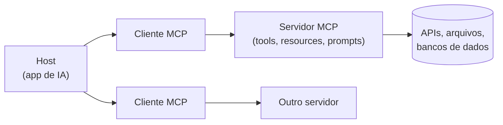

# MCP: minhas anotações de estudo

[](https://github.com/FloraRosaPupo/mcp-estudos/actions/workflows/testes.yml)

Anotações pessoais, em português, sobre o **Model Context Protocol (MCP)**, feitas enquanto eu estudava os cursos [MCP: Build Rich-Context AI Apps with Anthropic](https://www.deeplearning.ai/courses/mcp-build-rich-context-ai-apps-with-anthropic) (DeepLearning.AI) e [Model Context Protocol: Advanced Topics](https://anthropic.skilljar.com/model-context-protocol-advanced-topics) (Anthropic Academy).

Cada nota tem **fluxograma** e **exemplo**, e separa o que é **obrigatório** pelo protocolo do que é só **convenção** ou **específico do exemplo**.

> Este repositório **não** reproduz o material dos cursos. São resumos com as minhas palavras, diagramas próprios e código reescrito e corrigido. Para o conteúdo completo, faça os cursos oficiais.

## Visão geral



O MCP padroniza como aplicações de IA se conectam a ferramentas e dados: você escreve um servidor uma vez e ele funciona em qualquer host compatível (Claude Desktop, IDEs, seu próprio chatbot).

## Notas

| # | Nota | O que cobre |
|---|---|---|
| 01 | [Fundamentos](notas/01-fundamentos.md) | Host, cliente, servidor, primitivas, JSON-RPC, ciclo de vida |
| 02 | [Transportes](notas/02-transportes.md) | stdio, Streamable HTTP, JSON × SSE, o SSE antigo |
| 03 | [Tool use (antes do MCP)](notas/03-tool-use.md) | O loop do agente e as 3 regras da API |
| 04 | [Criando um servidor](notas/04-servidor.md) | FastMCP, schema automático, MCP Inspector |
| 05 | [Criando um cliente](notas/05-cliente.md) | `stdio_client`, `ClientSession`, conversão de schema |
| 06 | [Vários servidores](notas/06-varios-servidores.md) | `server_config.json`, `tool_to_session`, `AsyncExitStack` |
| 07 | [Resources e prompts](notas/07-resources-e-prompts.md) | Quem aciona cada primitiva |
| 08 | [Claude Desktop](notas/08-claude-desktop.md) | Configuração e problemas comuns |
| 09 | [Servidores remotos e deploy](notas/09-servidores-remotos.md) | Streamable HTTP, Docker, produção |
| 10 | [Além do básico](notas/10-alem-do-basico.md) | OAuth, roots, sampling, registry, spec 2026-07-28 |
| 11 | [Testando servidores e agentes MCP](notas/11-testes.md) | Testes de unidade, de protocolo, de integração e avaliação (evals) |

Extras:
- [Pegadinhas que encontrei](notas/pegadinhas.md)
- [SDK Python v1 × v2](notas/sdk-v1-vs-v2.md)

## Código

Versões revisadas do servidor e do chatbot, com as correções descritas nas notas.

| Arquivo | O que é |
|---|---|
| [`codigo/research_server.py`](codigo/research_server.py) | Servidor MCP com 2 tools, 2 resources e 1 prompt (stdio ou HTTP) |
| [`codigo/mcp_chatbot.py`](codigo/mcp_chatbot.py) | Chatbot que se conecta a vários servidores (stdio e HTTP) |
| [`codigo/server_config.json`](codigo/server_config.json) | Configuração dos servidores |

### Como rodar

```bash
cd codigo
uv sync                     # instala as dependências do pyproject.toml
cp .env.example .env        # coloque sua ANTHROPIC_API_KEY

# testar o servidor sozinho
npx @modelcontextprotocol/inspector uv run research_server.py

# rodar o chatbot (conecta nos servidores do server_config.json)
uv run mcp_chatbot.py
```

No chatbot:

| Comando | O que faz |
|---|---|
| texto normal | Pergunta ao Claude, que usa as tools quando precisar |
| `@folders` | Lista os temas salvos (resource) |
| `@ai_interpretability resuma os artigos` | Lê o resource e envia como contexto da pergunta |
| `/prompts` | Lista os prompts disponíveis |
| `/prompt generate_search_prompt topic=history num_papers=2` | Executa um prompt |

Para rodar o servidor como **remoto** (Streamable HTTP em `http://localhost:8000/mcp`):

```bash
MCP_TRANSPORT=http uv run research_server.py
```

### Testes

```bash
cd codigo
uv run pytest -v
```

São 36 testes, em 4 camadas, e nenhum precisa de internet nem de chave de API (o arXiv e o Claude são simulados):

| Arquivo | O que testa |
|---|---|
| [`test_server_funcoes.py`](codigo/tests/test_server_funcoes.py) | As funções do servidor como Python comum: tools, resources, prompt, logs no stderr |
| [`test_server_protocolo.py`](codigo/tests/test_server_protocolo.py) | Um cliente MCP real conversando com o servidor em memória: schema gerado, `tools/call`, `resources/read`, `prompts/get` |
| [`test_stdio.py`](codigo/tests/test_stdio.py) | O servidor rodando de verdade como subprocesso, via stdio |
| [`test_chatbot.py`](codigo/tests/test_chatbot.py) | O loop do chatbot com o Claude simulado: tools em paralelo, várias rodadas, erros, roteamento entre servidores |

A cada push e pull request, o GitHub Actions roda os testes com guardrails: checagem de `.env` versionado, busca de chaves vazadas (gitleaks), lint (ruff), permissões só de leitura e testes em Python 3.10 e 3.12. O Dependabot avisa quando há atualizações. Explicação completa na [nota 11](notas/11-testes.md).

> O código usa o **SDK v1** (`mcp<2`), o mesmo do curso. Veja [SDK v1 × v2](notas/sdk-v1-vs-v2.md) para migrar. O `fetch` e o `filesystem` do `server_config.json` precisam de `uvx` e `npx` (Node.js) instalados.

## Referências

- [Curso: MCP: Build Rich-Context AI Apps with Anthropic](https://www.deeplearning.ai/courses/mcp-build-rich-context-ai-apps-with-anthropic)
- [Curso: Model Context Protocol: Advanced Topics (Anthropic Academy)](https://anthropic.skilljar.com/model-context-protocol-advanced-topics)
- [Documentação oficial do MCP](https://modelcontextprotocol.io)
- [SDK Python](https://github.com/modelcontextprotocol/python-sdk) · [Guia de migração v1 → v2](https://py.sdk.modelcontextprotocol.io/migration/)
- [Servidores de referência](https://github.com/modelcontextprotocol/servers)
- [MCP Registry](https://registry.modelcontextprotocol.io)
