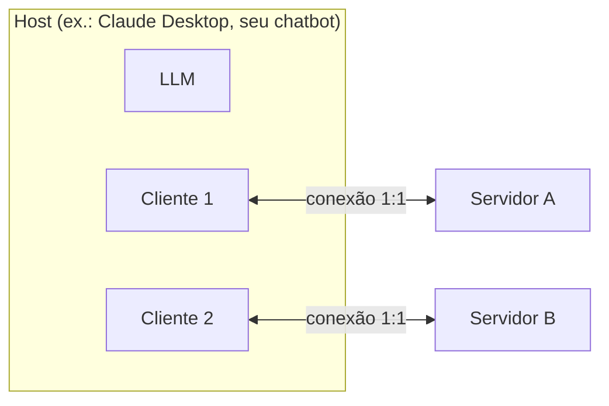
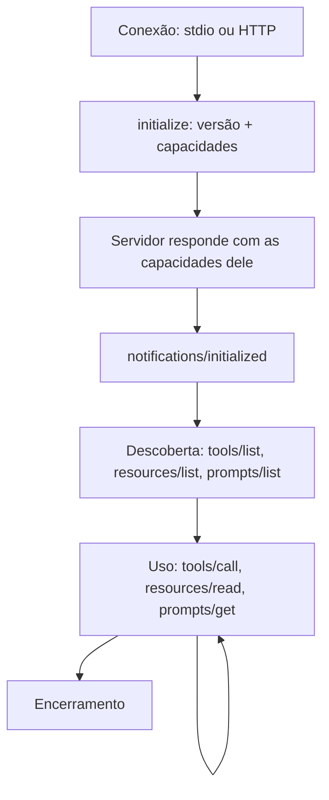

# 01 · Fundamentos

## O problema que o MCP resolve

Sem um padrão, cada app de IA precisa de uma integração própria para cada serviço (GitHub, Drive, banco de dados…). São **N apps × M serviços** integrações. Com o MCP, cada serviço expõe **um servidor** e cada app implementa **um cliente**: viram **N + M**.

## Arquitetura



| Papel | O que faz | Exemplo |
|---|---|---|
| **Host** | A aplicação que o usuário usa; contém o LLM e os clientes | Claude Desktop, uma IDE, o chatbot do curso |
| **Cliente** | Mantém **uma** conexão com **um** servidor | `ClientSession` do SDK Python |
| **Servidor** | Expõe capacidades | `research_server.py` |

## As primitivas

**Oferecidas pelo servidor:**

| Primitiva | Quem decide usar | Analogia |
|---|---|---|
| **Tools** | O modelo | Funções que o LLM chama |
| **Resources** | A aplicação / o usuário | Um GET de API: só leitura |
| **Prompts** | O usuário | Atalhos com prompts prontos |

**Oferecidas pelo cliente** (ver [nota 10](10-alem-do-basico.md)):

| Primitiva | Para quê |
|---|---|
| **Roots** | Dizer ao servidor onde ele pode trabalhar |
| **Sampling** | Deixar o servidor pedir uma inferência ao LLM do cliente |

## As mensagens

Tudo é **JSON-RPC 2.0**, independente do transporte. Três tipos:

```json
// Request: espera resposta (tem id)
{"jsonrpc": "2.0", "id": 1, "method": "tools/call",
 "params": {"name": "search_papers", "arguments": {"topic": "LLM"}}}

// Result: a resposta (mesmo id)
{"jsonrpc": "2.0", "id": 1, "result": {"content": [{"type": "text", "text": "2401.12345v1"}]}}

// Notification: não espera resposta (sem id)
{"jsonrpc": "2.0", "method": "notifications/tools/list_changed"}
```

## Ciclo de vida (SDK v1 / specs até 2025-11-25)



> 🆕 Na spec **2026-07-28**, o handshake `initialize`/`initialized` e o header `Mcp-Session-Id` foram removidos: o protocolo ficou stateless. Detalhes na [nota 10](10-alem-do-basico.md).

## Exemplo do fluxo completo

Pergunta: *"Busque artigos sobre física quântica"*

1. O host envia a pergunta + a lista de tools ao LLM.
2. O LLM decide chamar `search_papers(topic="física quântica")`.
3. O cliente envia `tools/call` ao servidor.
4. O servidor executa a função (que consulta o arXiv).
5. O resultado volta pelo cliente ao LLM, que escreve a resposta.

O LLM **nunca** acessa o arXiv diretamente: ele só decide qual tool usar.
