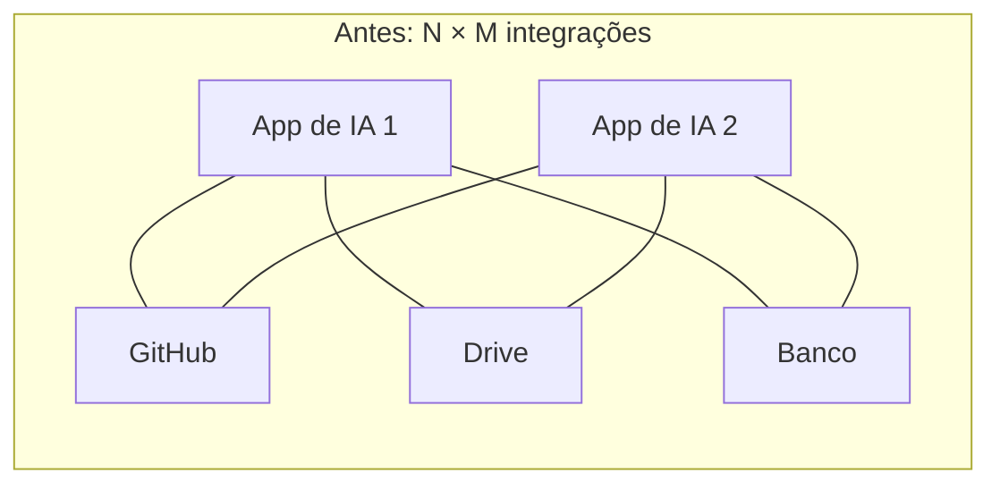
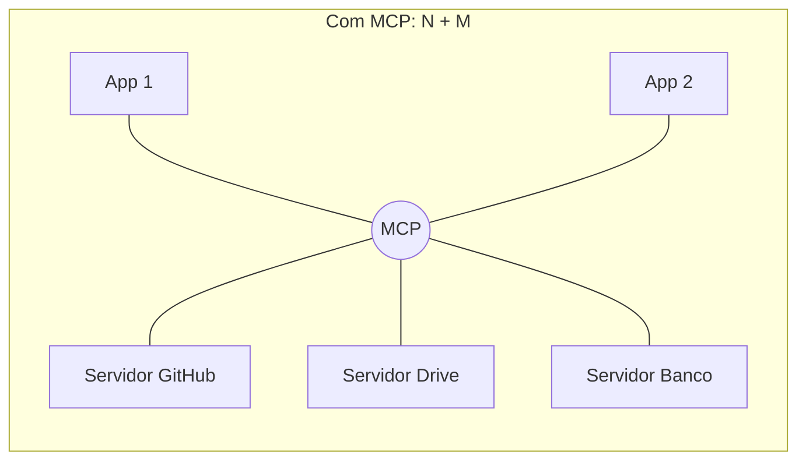
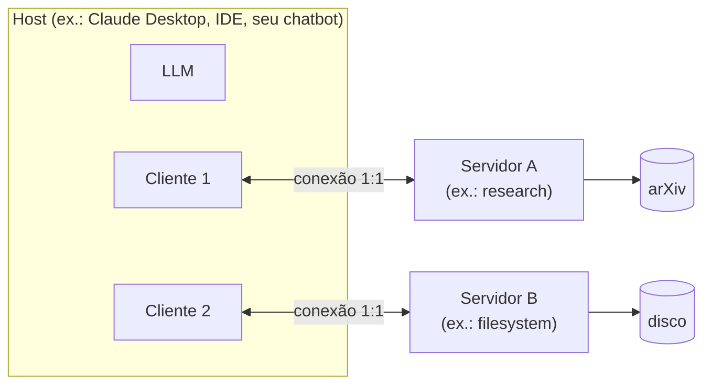
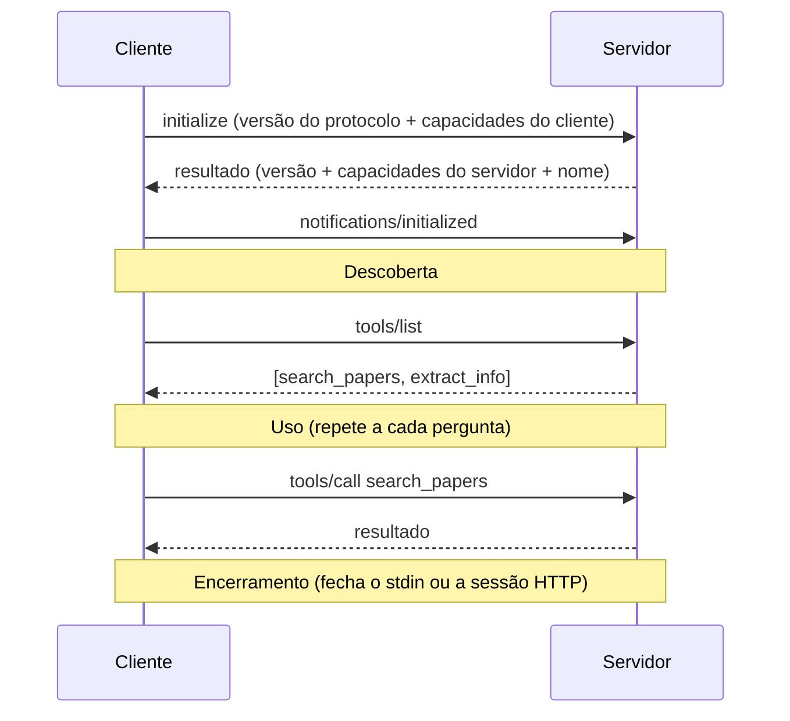
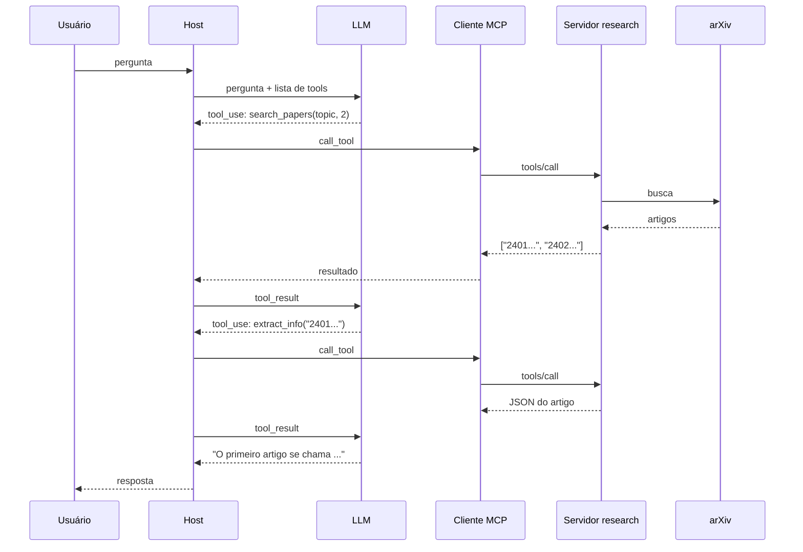

# 01 · Fundamentos

> **Nesta nota:** por que o MCP existe, quem é quem na arquitetura (host, cliente, servidor), as primitivas, o formato das mensagens e o ciclo de vida de uma conexão.

## 1. O problema que o MCP resolve

Um LLM sozinho só sabe o que estava nos dados de treino. Para ser útil no dia a dia, ele precisa de **contexto**: ler seus arquivos, consultar uma API, buscar no banco de dados, abrir um ticket.

Antes do MCP, cada aplicação de IA fazia isso do seu jeito:



Com 3 apps e 3 serviços, são 9 integrações diferentes, cada uma com seu formato, autenticação e bugs.

Com o MCP, cada serviço escreve **um servidor** e cada aplicação implementa **um cliente**. Todo mundo fala o mesmo protocolo:



A analogia mais usada é a da **porta USB-C**: em vez de um cabo diferente para cada aparelho, um conector padrão.

## 2. Arquitetura: host, cliente e servidor



| Papel | O que faz | Exemplo |
|---|---|---|
| **Host** | A aplicação que o usuário usa. Contém o LLM, gerencia os clientes e decide o que mostrar ao usuário | Claude Desktop, Cursor, o chatbot destas notas |
| **Cliente** | Vive dentro do host e mantém **uma** conexão com **um** servidor. Traduz chamadas do host em mensagens do protocolo | `ClientSession` do SDK Python |
| **Servidor** | Programa que expõe capacidades (tools, resources, prompts) de um sistema externo | `research_server.py`, servidor do GitHub, do Miro |

Pontos que confundem no começo:

- **O LLM não fala MCP.** Quem fala MCP é o cliente. O LLM só vê uma lista de tools (no formato da API dele) e decide qual usar; o host traduz isso em chamadas MCP.
- **Um cliente = um servidor.** Se o host se conecta a 3 servidores, ele tem 3 clientes.
- **Servidor não é necessariamente remoto.** Pode ser um processo local que o host inicia (stdio) ou um serviço na nuvem (HTTP). Ver [nota 02](02-transportes.md).

## 3. As primitivas

O protocolo define "primitivas": os tipos de coisa que cada lado pode oferecer.

### Oferecidas pelo servidor

| Primitiva | Quem decide usar | Analogia | Exemplo |
|---|---|---|---|
| **Tools** | O **modelo** | Uma função que o LLM pode chamar | `search_papers(topic)` |
| **Resources** | A **aplicação** ou o **usuário** | Um GET de API REST: só leitura | `papers://folders` |
| **Prompts** | O **usuário** | Um atalho com um prompt bem escrito | `/prompt generate_search_prompt` |

A coluna "quem decide" é a mais importante:

- Uma **tool** pode ser chamada a qualquer momento, sem o usuário pedir explicitamente. Por isso tools que **alteram** coisas (apagar, enviar, pagar) exigem cuidado.
- Um **resource** é dado pronto para leitura; a aplicação escolhe quando anexá-lo ao contexto.
- Um **prompt** é um modelo de instrução que o usuário escolhe usar.

### Oferecidas pelo cliente

| Primitiva | Para quê |
|---|---|
| **Roots** | O cliente diz ao servidor em quais pastas/URIs ele pode trabalhar |
| **Sampling** | O servidor pede ao cliente: "use o seu LLM para gerar isto" |

Detalhes na [nota 10](10-alem-do-basico.md).

## 4. As mensagens: JSON-RPC 2.0

Todas as mensagens do MCP seguem o **JSON-RPC 2.0**, em UTF-8, independente do transporte. Há três tipos:

```json
// 1. Request: pede algo e espera resposta (tem "id")
{"jsonrpc": "2.0", "id": 1, "method": "tools/call",
 "params": {"name": "search_papers", "arguments": {"topic": "LLM", "max_results": 2}}}

// 2. Response: a resposta, com o MESMO "id"
{"jsonrpc": "2.0", "id": 1,
 "result": {"content": [{"type": "text", "text": "2401.12345v1"},
                        {"type": "text", "text": "2402.67890v2"}],
            "isError": false}}

// 3. Notification: aviso que não espera resposta (sem "id")
{"jsonrpc": "2.0", "method": "notifications/tools/list_changed"}
```

Se algo dá errado no protocolo (método inexistente, parâmetro inválido), a resposta vem com `error` em vez de `result`:

```json
{"jsonrpc": "2.0", "id": 1, "error": {"code": -32602, "message": "Invalid params"}}
```

Já um erro **dentro da tool** (ex.: a API externa caiu) costuma voltar como `result` com `"isError": true`, para que o LLM veja a mensagem e possa reagir.

### Os métodos mais usados

| Método | Quem envia | Para quê |
|---|---|---|
| `initialize` | Cliente | Abrir a conexão (até a spec 2025-11-25) |
| `tools/list` / `tools/call` | Cliente | Descobrir e executar tools |
| `resources/list` / `resources/read` | Cliente | Descobrir e ler resources |
| `resources/templates/list` | Cliente | Descobrir resources com parâmetros |
| `prompts/list` / `prompts/get` | Cliente | Descobrir e obter prompts |
| `notifications/*/list_changed` | Servidor | Avisar que a lista mudou |
| `sampling/createMessage` | Servidor | Pedir uma inferência ao cliente |
| `roots/list` | Servidor | Perguntar quais roots o cliente liberou |

## 5. Ciclo de vida (SDK v1 / specs até 2025-11-25)



As **capacidades** trocadas no `initialize` dizem o que cada lado suporta. Por exemplo, um servidor que só tem tools não anuncia `resources`, e o cliente sabe que não deve chamar `resources/list`.

> 🆕 Na spec **2026-07-28**, o handshake `initialize`/`initialized` e o header `Mcp-Session-Id` foram removidos: cada requisição carrega a versão e as capacidades, e o protocolo ficou **stateless**. O curso e o código destas notas usam a versão anterior (SDK v1). Detalhes na [nota 10](10-alem-do-basico.md).

## 6. Exemplo completo, do começo ao fim

Pergunta do usuário: *"Busque 2 artigos sobre física quântica e me diga o título do primeiro."*



Repare: o LLM **nunca** acessa o arXiv. Ele só decide, com base nas descrições, qual tool chamar e com quais argumentos.

## Para fixar

1. Num host conectado a 4 servidores, quantos clientes MCP existem?
2. Qual a diferença entre uma tool e um resource em relação a **quem decide** usá-los?
3. Uma tool que chama uma API fora do ar deve devolver um `error` do JSON-RPC ou um `result` com `isError: true`? Por quê?

<details><summary>Respostas</summary>

1. Quatro: cada cliente mantém uma conexão 1:1 com um servidor.
2. A tool é escolhida pelo modelo; o resource é escolhido pela aplicação ou pelo usuário.
3. `result` com `isError: true`: assim o LLM vê a mensagem de erro e pode tentar outra abordagem. O `error` do JSON-RPC é para falhas do protocolo (método ou parâmetros inválidos).

</details>
