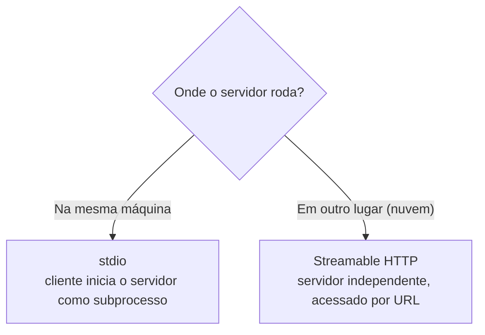
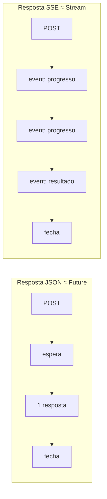
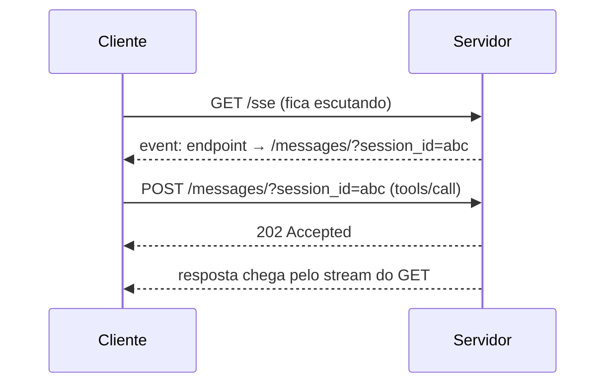

# 02 · Transportes

O transporte é só o **"cano"**: as mensagens JSON-RPC são as mesmas em todos.



## stdio

- O cliente **inicia o servidor como subprocesso**.
- Cliente escreve no `stdin` do servidor; servidor responde no `stdout`.
- Uma mensagem por linha.
- ⚠️ **Nada além de mensagens MCP pode ir para o `stdout`**. Logs vão para o `stderr`.

```
→ stdin:  {"jsonrpc":"2.0","id":2,"method":"tools/list"}
← stdout: {"jsonrpc":"2.0","id":2,"result":{"tools":[...]}}
```

## Streamable HTTP

- O servidor é um processo independente que atende **vários clientes**.
- Cada mensagem do cliente é um **POST** para um único endpoint (normalmente `/mcp`).
- A resposta vem **no mesmo POST**, em um de dois formatos. **Quem escolhe é o servidor**; o cliente precisa aceitar os dois (`Accept: application/json, text/event-stream`).



**Nenhum dos dois é polling**: nos dois casos é um único POST. A diferença é se a informação chega toda no final (JSON) ou aos poucos (SSE).

| Use resposta JSON quando… | Use SSE quando… |
|---|---|
| A tool é rápida e devolve um resultado | A tool demora e vale mostrar progresso |
| A infraestrutura atrapalha conexões longas | O servidor precisa mandar algo no meio (logs, pedidos ao cliente) |

Opcionalmente, o cliente pode abrir um **GET** no endpoint para receber mensagens que o servidor manda por iniciativa própria.

### Analogia com Flutter

```dart
final response = await client.send(request);
final tipo = response.headers['content-type'] ?? '';

if (tipo.contains('application/json')) {
  final body = await response.stream.bytesToString();   // tudo de uma vez
} else if (tipo.contains('text/event-stream')) {
  response.stream
      .transform(utf8.decoder)
      .transform(const LineSplitter())
      .where((l) => l.startsWith('data: '))
      .listen((l) { /* evento a evento */ });
}
```

## O SSE antigo (legado)

O transporte "HTTP+SSE" da spec 2024-11-05 usava **dois endpoints**, e a resposta voltava por um caminho diferente da pergunta:



Ele foi **substituído pelo Streamable HTTP**. Ainda aparece em tutoriais antigos como `transport="sse"`.

## stdio × remoto

| | stdio | Remoto (HTTP) |
|---|---|---|
| Quem inicia o servidor | O cliente | Você / a nuvem, antes |
| Como o cliente acha o servidor | `command` + `args` | URL |
| Clientes por servidor | 1 | Vários |
| `print()` no stdout | ❌ Quebra o protocolo | ✅ Sem problema |
| Autenticação | Variáveis de ambiente | OAuth 2.1 (recomendado) |
