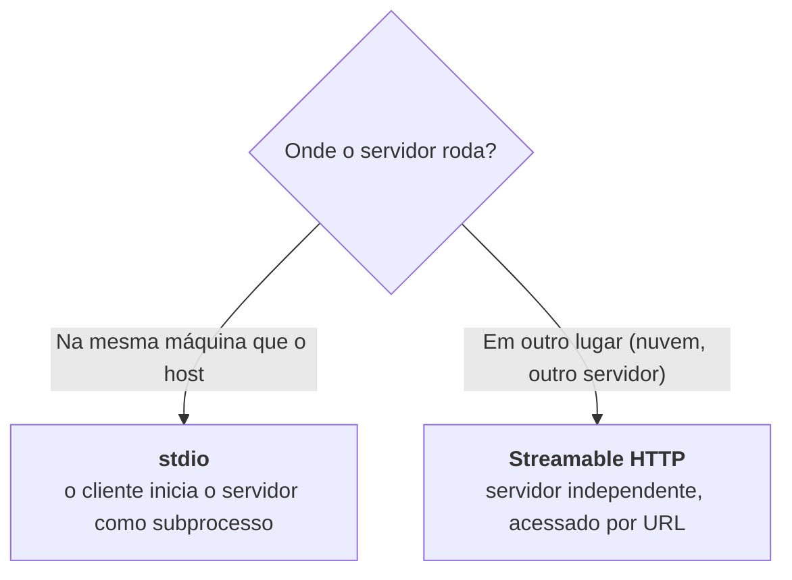
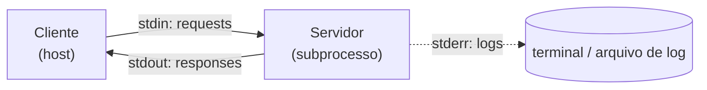
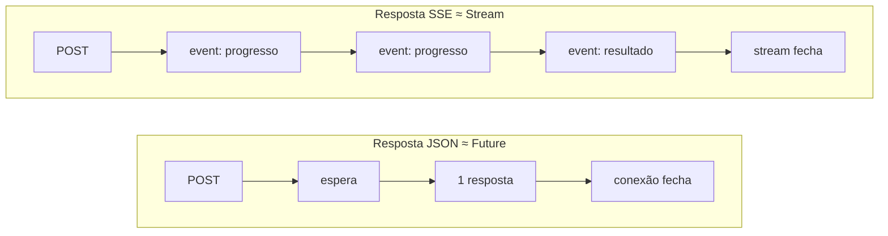
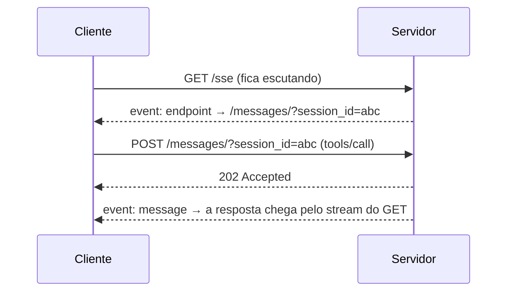

# 02 · Transportes

> **Nesta nota:** como as mensagens viajam entre cliente e servidor: stdio para servidores locais, Streamable HTTP para remotos, a diferença entre resposta JSON e SSE, e o transporte SSE antigo.

O transporte é só o **"cano"**. As mensagens JSON-RPC da [nota 01](01-fundamentos.md) são exatamente as mesmas em todos os transportes; muda apenas como os bytes vão de um lado para o outro.



## 1. stdio

O cliente **inicia o servidor como um subprocesso** e conversa com ele pelos fluxos padrão do sistema operacional:



Regras:

- Cada mensagem é **uma linha** de JSON (sem quebras de linha dentro).
- O servidor lê do `stdin` e escreve no `stdout`.
- **Atenção:** nada além de mensagens MCP pode ir para o `stdout`. Um `print("debug")` vira uma linha que não é JSON-RPC válido e quebra a comunicação. Logs vão para o `stderr`.
- O servidor vive enquanto o cliente viver: quando o host fecha, o subprocesso termina.

Exemplo do que passa pelo cano quando o host pede a lista de tools:

```
→ stdin:  {"jsonrpc":"2.0","id":2,"method":"tools/list"}
← stdout: {"jsonrpc":"2.0","id":2,"result":{"tools":[{"name":"search_papers",...},{"name":"extract_info",...}]}}
```

**Vantagens:** simples, sem rede, sem porta, sem autenticação (as credenciais vão por variável de ambiente). A especificação recomenda que os clientes suportem stdio sempre que possível.

**Limitações:** só funciona na mesma máquina, e cada cliente tem o seu próprio processo do servidor.

## 2. Streamable HTTP

O servidor é um **processo independente**, já rodando, que atende **vários clientes** por uma URL.

- Cada mensagem do cliente é um **POST** para um único endpoint (normalmente `/mcp`).
- O cliente envia o header `Accept: application/json, text/event-stream`, avisando que aceita os dois formatos de resposta.
- **Quem escolhe o formato é o servidor**, a cada requisição.



### JSON × SSE, na linha do tempo

```mermaid
gantt
    dateFormat  s
    axisFormat  %Ss
    section JSON
    esperando (tela de loading)    :a1, 0, 3s
    resultado                      :milestone, 3, 0s
    section SSE
    "Buscando no arXiv..."         :milestone, 1, 0s
    "50%"                          :milestone, 2, 0s
    resultado                      :milestone, 3, 0s
```



O resultado final chega **no mesmo momento** nos dois casos. Com SSE, o usuário vê alguma coisa enquanto espera.

**Nenhum dos dois é polling.** Polling seria o cliente perguntar de novo a cada segundo "já terminou?". Aqui é sempre um único POST; a diferença é se a informação chega toda no final (JSON) ou aos poucos (SSE).

| Use resposta JSON quando… | Use SSE quando… |
|---|---|
| A tool é rápida e devolve um resultado só | A tool demora e vale mostrar progresso |
| Ex.: `extract_info` lendo um arquivo local | Ex.: `search_papers` consultando o arXiv |
| A infraestrutura atrapalha conexões longas (alguns proxies e ambientes serverless) | O servidor precisa mandar algo no meio (logs, pedidos ao cliente) |

No FastMCP (SDK v1), dá para forçar respostas JSON com `FastMCP("nome", json_response=True)`.

### O GET opcional

Além dos POSTs, o cliente pode abrir um **GET** no mesmo endpoint e deixar um stream SSE aberto. Por ele, o servidor manda mensagens **por iniciativa própria**, como `notifications/tools/list_changed` ("surgiu uma tool nova"). É opcional.

### Sessões (SDK v1)

Na versão do protocolo usada pelo curso, o servidor pode criar uma sessão no `initialize` e devolver um header `Mcp-Session-Id`, que o cliente repete em todas as requisições seguintes. Se o servidor responder 404 para esse ID, o cliente precisa iniciar uma sessão nova.

> **Atualização:** Na spec 2026-07-28, sessões e o `Mcp-Session-Id` foram removidos, e as requisições HTTP passaram a levar os headers `Mcp-Method` e `Mcp-Name`. Ver [nota 10](10-alem-do-basico.md).

### Segurança

Servidores HTTP devem validar o header `Origin` em todas as conexões, para evitar ataques de **DNS rebinding** (um site malicioso tentando falar com um servidor MCP que roda na sua máquina). Servidores remotos devem usar autenticação, de preferência OAuth 2.1.

## 3. Analogia com Flutter

Como quem escolhe o formato é o servidor, o app precisa tratar os dois casos olhando o `Content-Type`:

```dart
final request = http.Request('POST', Uri.parse('https://meuservidor.com/mcp'))
  ..headers['Accept'] = 'application/json, text/event-stream'
  ..body = jsonEncode(toolsCall);

final response = await client.send(request);
final tipo = response.headers['content-type'] ?? '';

if (tipo.contains('application/json')) {
  // ≈ Future: espera tudo e mostra uma vez
  final body = await response.stream.bytesToString();
  mostrarResultado(jsonDecode(body));
} else if (tipo.contains('text/event-stream')) {
  // ≈ Stream: vai mostrando conforme os eventos chegam
  response.stream
      .transform(utf8.decoder)
      .transform(const LineSplitter())
      .where((linha) => linha.startsWith('data: '))
      .listen((linha) {
    final msg = jsonDecode(linha.substring(6));
    if (msg['method'] == 'notifications/progress') {
      atualizarProgresso(msg['params']);
    } else if (msg['result'] != null) {
      mostrarResultado(msg['result']);
    }
  });
}
```

Regra prática no Flutter: **um valor → `Future`** (`FutureBuilder`); **vários valores ao longo do tempo → `Stream`** (`StreamBuilder`).

## 4. O SSE antigo (legado)

O transporte "HTTP+SSE" da spec 2024-11-05 usava **dois endpoints**, e a resposta voltava por um caminho diferente da pergunta:



Ele foi **substituído pelo Streamable HTTP** na spec 2025-03-26. Ainda aparece em tutoriais e cursos gravados antes disso, como `mcp.run(transport="sse")` e `sse_client(url=".../sse")`. Em projetos novos, use Streamable HTTP.

## 5. Resumo: stdio × remoto

| | stdio | Remoto (Streamable HTTP) |
|---|---|---|
| Quem inicia o servidor | O cliente | Você ou a nuvem, antes de tudo |
| Como o cliente acha o servidor | `command` + `args` | URL |
| Clientes por servidor | 1 | Vários |
| `print()` no stdout | Quebra o protocolo | Sem problema |
| Autenticação | Variáveis de ambiente | OAuth 2.1 (recomendado) |
| Exemplo | `uv run research_server.py` | `https://mcp.miro.com/` |

## Para fixar

1. Por que um `print()` quebra um servidor stdio, mas não um servidor HTTP?
2. Na resposta SSE, o resultado final chega antes do que na resposta JSON?
3. Num servidor HTTP, quem decide se a resposta vem em JSON ou SSE?

<details><summary>Respostas</summary>

1. No stdio, o stdout é o canal das mensagens do protocolo; no HTTP, as mensagens vão pela conexão HTTP e o stdout é só um terminal.
2. Não. Chega no mesmo momento; a diferença é que eventos intermediários (como progresso) podem chegar antes.
3. O servidor. O cliente só avisa, pelo `Accept`, que aceita os dois.

</details>
