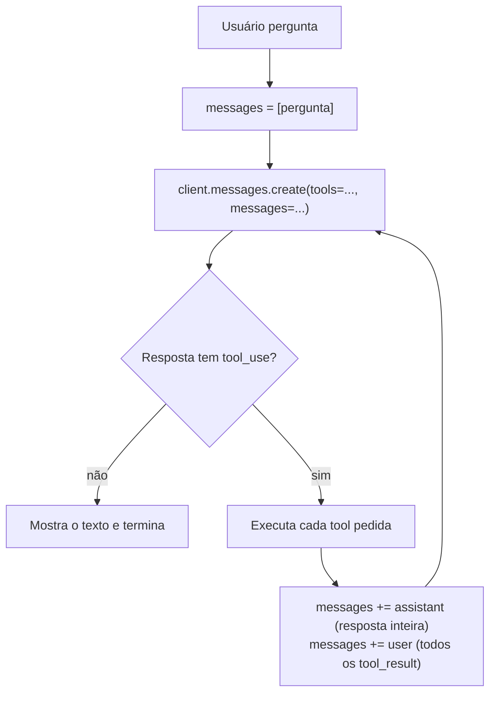

# 03 · Tool use (antes do MCP)

Antes de usar MCP, vale entender o **tool use** puro da API do Claude: as tools ficam no mesmo arquivo do chatbot, e o MCP depois só muda **de onde elas vêm** e **como são executadas**.

## O loop do agente



Exemplo, com a pergunta *"busque 2 artigos sobre LLM interpretability e me diga o título do primeiro"*:

1. **1ª volta:** Claude pede `search_papers(topic=..., max_results=2)` → volta uma lista de IDs.
2. **2ª volta:** Claude pede `extract_info(paper_id=...)` → volta o JSON do artigo.
3. **3ª volta:** Claude responde só com texto → fim do loop.

## As 3 regras obrigatórias

Quebrar qualquer uma faz a API devolver erro:

```python
# 1. Devolver a resposta do Claude inteira ao histórico (texto + tool_use)
messages.append({"role": "assistant", "content": response.content})

# 2. Cada tool_result aponta para o tool_use correspondente
{"type": "tool_result", "tool_use_id": block.id, "content": resultado}

# 3. Todos os tool_results da rodada vão juntos, numa única mensagem "user"
messages.append({"role": "user", "content": tool_results})
```

Exemplo de erro: o Claude pede duas tools na mesma resposta e você manda os resultados em mensagens separadas → a API reclama que falta o `tool_result` de um dos `tool_use`.

## Obrigatório × convenção

| Parte | Nível |
|---|---|
| Schema da tool (`name`, `description`, `input_schema`) | Formato obrigatório; conteúdo é seu |
| As 3 regras acima | Obrigatório |
| Dicionário `nome → função` para executar | Convenção (no MCP vira `session.call_tool`) |
| `stop_reason == "tool_use"` vs checar os blocos | Equivalentes |

## O que muda com MCP

| Sem MCP | Com MCP |
|---|---|
| Funções no mesmo arquivo | Funções num servidor separado |
| Schema escrito à mão | Gerado automaticamente (type hints + docstring) |
| Lista de tools fixa | Descoberta com `list_tools()` |
| `execute_tool(nome, args)` | `session.call_tool(nome, arguments=args)` |

O loop em si **não muda**.
