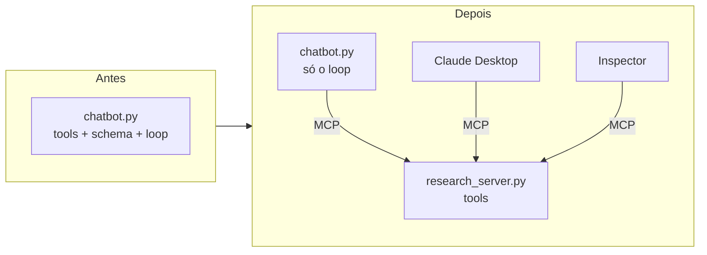
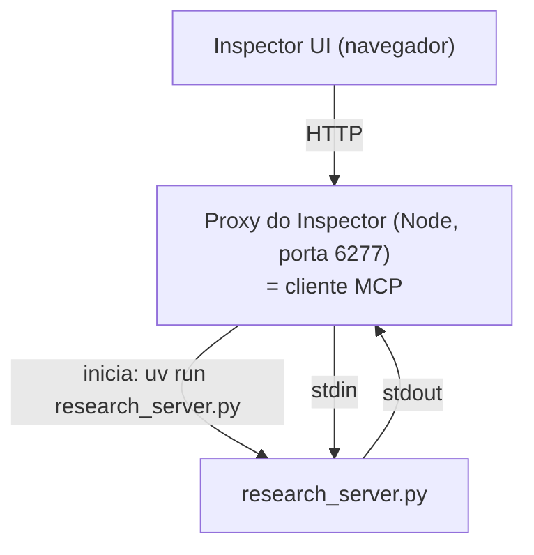

# 04 · Criando um servidor

> **Nesta nota:** como transformar funções Python num servidor MCP com o FastMCP, como o schema é gerado, como testar com o MCP Inspector e os erros mais comuns.

## 1. Do chatbot para o servidor

Na [nota 03](03-tool-use.md), as tools viviam dentro do chatbot. Agora elas vão para um **processo separado**, que qualquer host pode usar:



## 2. Duas formas de criar um servidor

| | Low-level (`Server`) | High-level (`FastMCP`) |
|---|---|---|
| Como funciona | Você trata cada requisição (`ListToolsRequest`, `CallToolRequest`) | Você escreve funções; o FastMCP cuida do protocolo |
| Schema | Escrito à mão | Gerado dos type hints e da docstring |
| Quando usar | Controle total, casos incomuns | Quase sempre |

## 3. Um servidor com FastMCP

```python
from typing import List
from mcp.server.fastmcp import FastMCP     # SDK v2: from mcp.server import MCPServer

mcp = FastMCP("research")                  # o nome aparece no initialize

@mcp.tool()
def search_papers(topic: str, max_results: int = 5) -> List[str]:
    """
    Search for papers on arXiv based on a topic and store their information.

    Args:
        topic: The topic to search for
        max_results: Maximum number of results to retrieve (default: 5)
    """
    ...

@mcp.tool()
def extract_info(paper_id: str) -> str:
    """Search for information about a specific paper across all topic directories."""
    ...

if __name__ == "__main__":
    mcp.run(transport="stdio")
```

O corpo das funções é **o mesmo** da versão sem MCP. O decorador só registra a função no servidor; ela continua chamável como Python comum (o que facilita os testes, ver [nota 11](11-testes.md)).

## 4. Como o schema é gerado

A partir da assinatura acima, o `tools/list` devolve:

```json
{
  "name": "search_papers",
  "description": "Search for papers on arXiv based on a topic and store their information.\n\nArgs: ...",
  "inputSchema": {
    "type": "object",
    "properties": {
      "topic":       {"title": "Topic", "type": "string"},
      "max_results": {"title": "Max Results", "type": "integer", "default": 5}
    },
    "required": ["topic"]
  }
}
```

| Na função | No schema |
|---|---|
| Nome da função | `name` |
| Docstring | `description` (o LLM lê isto para decidir quando usar a tool) |
| `topic: str` | `"type": "string"` |
| Parâmetro **sem** padrão | Entra em `required` |
| `max_results: int = 5` | Opcional, com `"default": 5` |

Por isso:

- **Type hints são obrigatórios na prática.** Sem eles, o LLM não sabe o tipo de cada argumento.
- **A docstring é parte da interface.** Uma descrição vaga ("faz busca") gera escolhas ruins de tool. Explique **quando** usar e **o que** volta.
- **Cuidado ao traduzir docstrings:** isso muda o que o LLM lê.

O retorno também é convertido: uma lista de strings vira conteúdo de texto no `CallToolResult`; um `str` vira um bloco de texto.

## 5. Testando com o MCP Inspector

O Inspector é um cliente MCP com interface web, para testar o servidor **sem LLM**:



```bash
npx @modelcontextprotocol/inspector uv run research_server.py
# atalho do SDK Python (precisa de: uv add "mcp[cli]"):
uv run mcp dev research_server.py
```

Os dois precisam de **Node.js**: o Inspector é um app Node, e o `mcp dev` chama o `npx` por baixo.

Na interface: **Connect** → aba **Tools** → **List Tools** → escolha uma tool → preencha os argumentos → **Run Tool**. As abas **Resources** e **Prompts** funcionam do mesmo jeito, e o histórico mostra as mensagens JSON-RPC trocadas.

## 6. Preparando o ambiente com `uv`

```bash
uv init                   # cria o projeto (pyproject.toml)
uv venv                   # cria o ambiente virtual
source .venv/bin/activate # Windows: .venv\Scripts\activate
uv add "mcp>=1.10,<2" arxiv
```

O `uv` é muito usado no ecossistema MCP (inclusive nas configurações do Claude Desktop), mas `pip` também funciona.

## 7. Obrigatório × convenção

| Parte | Nível |
|---|---|
| `FastMCP(...)` + `@mcp.tool()` | Obrigatório (no FastMCP) |
| Type hints e docstring | Obrigatório na prática |
| `mcp.run(transport="stdio")` | Padrão para servidores locais |
| Nome do servidor (`"research"`) | Livre |
| `uv` | Convenção do ecossistema |
| Inspector | Opcional, só para teste |

## 8. Erros comuns

```python
import os, sys

# Errado: print no stdout quebra o protocolo stdio
print(f"Salvo em: {path}")
# Certo:
print(f"Salvo em: {path}", file=sys.stderr)

# Errado: caminho relativo depende da pasta de onde o processo foi iniciado
#    (no Claude Desktop, quase nunca é a pasta do projeto)
PAPER_DIR = "papers"
# Certo: caminho baseado no próprio arquivo
PAPER_DIR = os.path.join(os.path.dirname(os.path.abspath(__file__)), "papers")

# Errado: quebra se a pasta ainda não existe
for item in os.listdir(PAPER_DIR): ...
# Certo:
if not os.path.isdir(PAPER_DIR):
    return "Nenhum artigo salvo ainda. Use search_papers primeiro."
```

E um erro de versão: o código do curso usa `from mcp.server.fastmcp import FastMCP`, que **não existe** no SDK v2 (`pip install mcp` instala a v2 hoje). Fixe `mcp<2` ou migre (ver [SDK v1 × v2](sdk-v1-vs-v2.md)).

Código completo: [`codigo/research_server.py`](../codigo/research_server.py).

## Para fixar

1. O que acontece com um parâmetro que tem valor padrão na função?
2. Por que a docstring importa tanto num servidor MCP?
3. Por que o Inspector precisa do Node.js mesmo para testar um servidor Python?

<details><summary>Respostas</summary>

1. Ele fica fora do `required` no schema, ou seja, é opcional para o LLM.
2. Ela vira a `description` da tool, que é o que o LLM usa para decidir quando e como chamá-la.
3. Porque o Inspector em si é um app Node.js; o servidor Python é só o processo que ele inicia.

</details>
