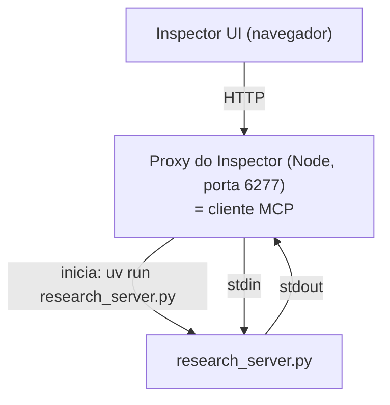

# 04 · Criando um servidor

## Transporte durante o desenvolvimento

Para testar sem LLM, uso o **MCP Inspector**, que é um cliente MCP com interface web:



```bash
npx @modelcontextprotocol/inspector uv run research_server.py
# ou, só para servidores Python:
uv run mcp dev research_server.py    # precisa de: uv add "mcp[cli]"
```

Os dois precisam de **Node.js**: o Inspector é um app Node, e o `mcp dev` só chama o `npx` por baixo.

## Uma tool com FastMCP

```python
from mcp.server.fastmcp import FastMCP     # SDK v2: from mcp.server import MCPServer

mcp = FastMCP("research")

@mcp.tool()
def search_papers(topic: str, max_results: int = 5) -> list[str]:
    """Search for papers on arXiv based on a topic and store their information."""
    ...

if __name__ == "__main__":
    mcp.run(transport="stdio")
```

## O schema é gerado sozinho

A partir da assinatura acima, o `tools/list` devolve:

```json
{
  "name": "search_papers",
  "description": "Search for papers on arXiv based on a topic...",
  "inputSchema": {
    "type": "object",
    "properties": {
      "topic":       {"type": "string"},
      "max_results": {"type": "integer", "default": 5}
    },
    "required": ["topic"]
  }
}
```

- Sem valor padrão → **obrigatório**; com `= 5` → opcional.
- A **docstring vira a descrição** que o LLM lê para decidir quando usar a tool. Por isso, mantenha docstrings claras (e cuidado ao traduzi-las: isso muda o comportamento).
- O MCP usa `inputSchema` (camelCase); a API do Claude usa `input_schema`. O cliente converte.

## Obrigatório × convenção

| Parte | Nível |
|---|---|
| `FastMCP(...)` + `@mcp.tool()` | Obrigatório (no FastMCP) |
| Type hints e docstring | Obrigatório na prática |
| `mcp.run(transport="stdio")` | Padrão para servidores locais |
| `uv` para o ambiente | Convenção do ecossistema (`pip` também funciona) |
| Inspector | Opcional, só para teste |

## Pegadinhas

```python
import sys, os

# ❌ print no stdout quebra o protocolo stdio
print(f"Salvo em: {path}")
# ✅
print(f"Salvo em: {path}", file=sys.stderr)

# ❌ caminho relativo depende de onde o processo foi iniciado
PAPER_DIR = "papers"
# ✅ caminho baseado no próprio arquivo
PAPER_DIR = os.path.join(os.path.dirname(os.path.abspath(__file__)), "papers")
```

Código completo: [`codigo/research_server.py`](../codigo/research_server.py).
