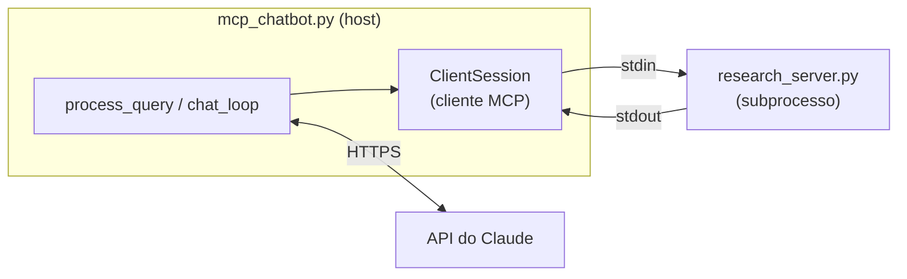
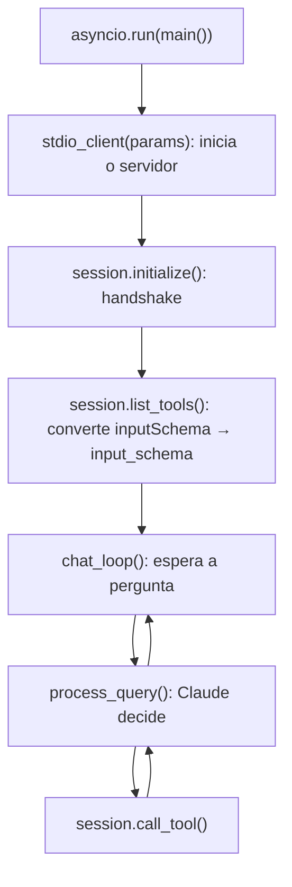

# 05 · Criando um cliente

O chatbot vira **host e cliente**: fala com o Claude por HTTPS e com o servidor MCP por stdio.



## Fluxo do código



## O essencial (SDK v1)

```python
from mcp import ClientSession, StdioServerParameters
from mcp.client.stdio import stdio_client

params = StdioServerParameters(command="uv", args=["run", "research_server.py"])

async with stdio_client(params) as (read, write):
    async with ClientSession(read, write) as session:
        await session.initialize()
        tools = (await session.list_tools()).tools
        available_tools = [{
            "name": t.name,
            "description": t.description,
            "input_schema": t.inputSchema,      # MCP → API do Claude
        } for t in tools]
        # ... loop do chat usando session.call_tool(nome, arguments=args)
```

| No código | Vai no stdin |
|---|---|
| `session.initialize()` | `initialize` + `notifications/initialized` |
| `session.list_tools()` | `tools/list` |
| `session.call_tool("search_papers", {...})` | `tools/call` |

## Convertendo o resultado

O `call_tool` devolve objetos do MCP. Em vez de passá-los direto à API, converto e aproveito o `isError`:

```python
result = await session.call_tool(block.name, arguments=block.input)
tool_results.append({
    "type": "tool_result",
    "tool_use_id": block.id,
    "content": [{"type": "text", "text": c.text} for c in result.content if c.type == "text"],
    "is_error": result.isError,
})
```

## Obrigatório × convenção

| Parte | Nível |
|---|---|
| `stdio_client` + `ClientSession` + `initialize()` | Obrigatório (SDK v1) |
| Converter `inputSchema` → `input_schema` | Obrigatório (formatos diferentes) |
| `async`/`await` | Obrigatório (o SDK é assíncrono) |
| Classe `MCP_ChatBot` | Convenção |
| `nest_asyncio` | Só necessário dentro do Jupyter |

> ⚠️ Cuidado com versões do loop que fazem um `append` por `tool_use` e só param quando `len(response.content) == 1`: quebram com tools em paralelo e podem entrar em loop infinito. Use o loop da [nota 03](03-tool-use.md). Detalhes em [pegadinhas](pegadinhas.md).
