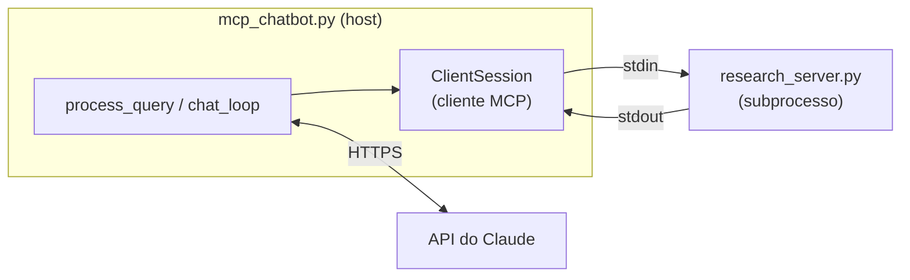
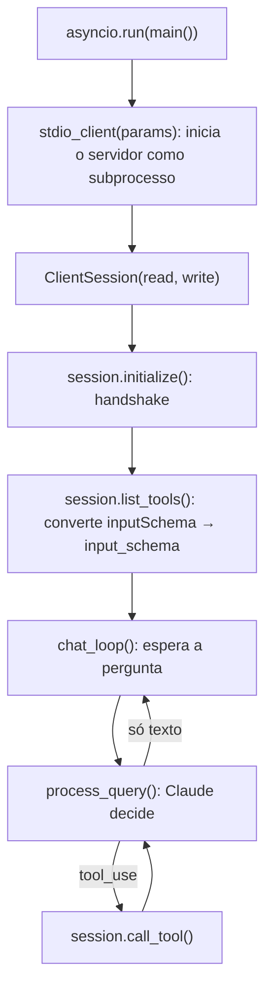

# 05 · Criando um cliente

> **Nesta nota:** como um chatbot vira host e cliente MCP, o que cada chamada do SDK faz no protocolo, a conversão de schema e o loop corrigido.

## 1. O chatbot vira host e cliente



Agora o chatbot fala com **dois lados**:
- com o **Claude**, por HTTPS (como antes);
- com o **servidor MCP**, por stdio (novo).

## 2. Fluxo do código



## 3. O essencial (SDK v1)

```python
import asyncio
from mcp import ClientSession, StdioServerParameters
from mcp.client.stdio import stdio_client

params = StdioServerParameters(
    command="uv",                          # executável
    args=["run", "research_server.py"],    # argumentos
    env=None,                              # variáveis de ambiente (opcional)
)

async def main():
    async with stdio_client(params) as (read, write):        # inicia o subprocesso
        async with ClientSession(read, write) as session:     # cria o cliente
            await session.initialize()                        # handshake
            tools = (await session.list_tools()).tools        # descoberta
            available_tools = [{
                "name": t.name,
                "description": t.description,
                "input_schema": t.inputSchema,                # MCP → API do Claude
            } for t in tools]
            # ... chat_loop() usando session.call_tool(nome, arguments=args)

asyncio.run(main())
```

### O que cada chamada envia

| No código | Mensagem no stdin |
|---|---|
| `stdio_client(params)` | Nenhuma: só inicia o processo e abre os fluxos |
| `session.initialize()` | `initialize` + `notifications/initialized` |
| `session.list_tools()` | `tools/list` |
| `session.call_tool("search_papers", {"topic": "IA"})` | `tools/call` com `name` e `arguments` |

## 4. Por que converter o schema

| | MCP | API do Claude |
|---|---|---|
| Campo do schema | `inputSchema` | `input_schema` |
| Campos usados | `name`, `description`, `inputSchema` | `name`, `description`, `input_schema` |

Alguém precisa traduzir, e esse alguém é o host. Sem a conversão, a API recusa a lista de tools.

## 5. Executando a tool e convertendo o resultado

O `call_tool` devolve um `CallToolResult` com uma lista de blocos (`TextContent`, `ImageContent`…) e um campo `isError`. Em vez de passar os objetos do MCP direto à API, converta para o formato dela e repasse o erro:

```python
result = await session.call_tool(block.name, arguments=block.input)
tool_results.append({
    "type": "tool_result",
    "tool_use_id": block.id,
    "content": [{"type": "text", "text": c.text}
                for c in result.content if c.type == "text"],
    "is_error": result.isError,
})
```

## 6. O loop completo, corrigido

```python
async def process_query(self, query):
    messages = [{"role": "user", "content": query}]
    while True:
        response = self.anthropic.messages.create(
            model="claude-sonnet-4-6", max_tokens=2048,
            tools=self.available_tools, messages=messages)
        messages.append({"role": "assistant", "content": response.content})

        tool_results = []
        for block in response.content:
            if block.type == "text":
                print(block.text)
            elif block.type == "tool_use":
                result = await self.session.call_tool(block.name, arguments=block.input)
                tool_results.append({...})          # como na seção 5

        if not tool_results:
            break
        messages.append({"role": "user", "content": tool_results})
```

> **Atenção:** Algumas versões do loop (inclusive a de algumas aulas) fazem um `append` por `tool_use` e só param quando `len(response.content) == 1`. Isso **quebra com tools em paralelo** (viola a regra 3) e **entra em loop infinito** se o Claude responder com 2 blocos de texto. Ver [pegadinhas](pegadinhas.md).

## 7. Por que tudo é `async`

O SDK do MCP é assíncrono: enquanto espera a resposta do servidor (que pode estar buscando no arXiv), o programa não fica travado. Por isso `initialize`, `list_tools` e `call_tool` usam `await`, e o programa começa com `asyncio.run(main())`.

O `nest_asyncio` que aparece em alguns exemplos só é necessário dentro do **Jupyter**, que já tem um loop de eventos rodando. No terminal, não precisa.

## 8. Obrigatório × convenção

| Parte | Nível |
|---|---|
| `stdio_client` + `ClientSession` + `initialize()` | Obrigatório (SDK v1) |
| Converter `inputSchema` → `input_schema` | Obrigatório |
| `async`/`await` | Obrigatório |
| Classe `MCPChatBot` | Convenção (organiza sessão e tools) |
| Converter o resultado e repassar `isError` | Recomendado |
| `nest_asyncio` | Só no Jupyter |

## 9. No SDK v2

```python
from mcp import Client, StdioServerParameters

async with Client(StdioServerParameters(command="uv", args=["run", "research_server.py"])) as client:
    tools = (await client.list_tools()).tools
    schema = tools[0].input_schema          # snake_case na v2
```

Os dois `async with` e o `initialize()` viram um único objeto. Ver [SDK v1 × v2](sdk-v1-vs-v2.md).

## Para fixar

1. Quem inicia o processo do servidor quando o transporte é stdio?
2. Por que o chatbot precisa converter `inputSchema` para `input_schema`?
3. O que acontece se o servidor não responder ao `initialize`?

<details><summary>Respostas</summary>

1. O cliente, pelo `stdio_client`, que roda o `command` com os `args` como subprocesso.
2. Porque o MCP e a API do Claude usam nomes diferentes para o mesmo campo, e a API recusa o formato do MCP.
3. A sessão não é estabelecida, e as outras chamadas (`list_tools`, `call_tool`) não funcionam (na spec atual, o handshake deixou de existir).

</details>
