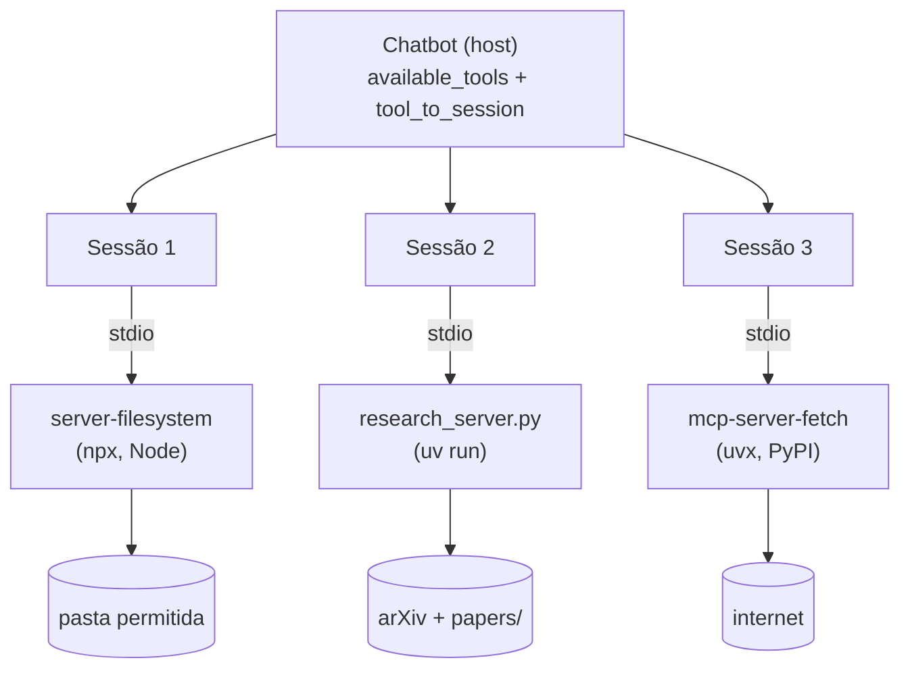
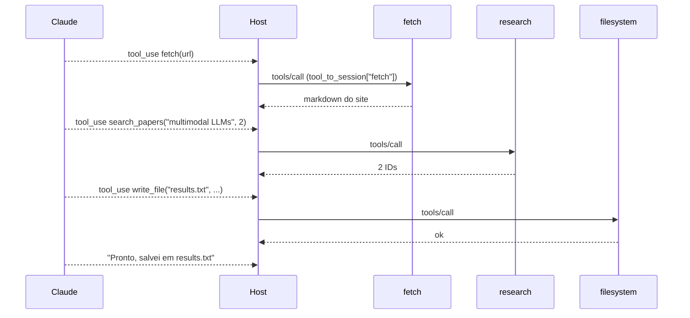

# 06 · Vários servidores

> **Nesta nota:** como um host se conecta a vários servidores ao mesmo tempo, o arquivo de configuração `mcpServers`, como o host sabe para qual servidor mandar cada chamada, o `AsyncExitStack` e os cuidados de segurança.

## 1. Um host, várias sessões



O Claude vê **uma lista única** de tools. Quem sabe de qual servidor cada tool veio é o host.

## 2. Servidores de referência

O repositório [modelcontextprotocol/servers](https://github.com/modelcontextprotocol/servers) tem implementações de referência, prontas para usar:

| Servidor | O que oferece | Como roda |
|---|---|---|
| `filesystem` | Ler, escrever, listar e buscar arquivos numa pasta que você define | `npx -y @modelcontextprotocol/server-filesystem <pasta>` |
| `fetch` | Buscar uma URL e devolver o conteúdo em markdown | `uvx mcp-server-fetch` |

`npx` e `uvx` baixam e rodam o pacote na hora, sem instalação prévia.

| Comando | O que faz |
|---|---|
| `uv run arquivo.py` | Roda um arquivo Python local, no ambiente do projeto |
| `uvx pacote` | Baixa e roda um pacote Python do PyPI num ambiente **isolado** |
| `npx -y pacote` | Baixa e roda um pacote Node do npm |

## 3. A configuração em JSON

Em vez de deixar os servidores fixos no código, o chatbot lê um arquivo:

```json
{
  "mcpServers": {
    "filesystem": { "command": "npx", "args": ["-y", "@modelcontextprotocol/server-filesystem", "./workspace"] },
    "research":   { "command": "uv",  "args": ["run", "research_server.py"] },
    "fetch":      { "command": "uvx", "args": ["--with", "mcp<2", "mcp-server-fetch"] },
    "miro":       { "url": "https://mcp.miro.com/" }
  }
}
```

- O formato `mcpServers` **não faz parte da especificação**, mas virou padrão de fato: é o mesmo do Claude Desktop, do Cursor e de outros hosts. Aprendendo aqui, você configura qualquer um deles.
- As chaves `command`, `args` e `env` batem exatamente com o `StdioServerParameters`, por isso dá para fazer `StdioServerParameters(**config)`.
- Entradas com `url` são servidores remotos (seção 7).

## 4. `available_tools` × `tool_to_session`

As duas estruturas são preenchidas no mesmo loop, mas respondem a perguntas diferentes:

```python
for tool in tools:
    self.tool_to_session[tool.name] = session          # onde a tool está
    self.available_tools.append({                      # o que a tool faz
        "name": tool.name,
        "description": tool.description,
        "input_schema": tool.inputSchema,
    })
```

| | `available_tools` | `tool_to_session` |
|---|---|---|
| Tipo | Lista | Dicionário |
| Guarda | Nome, descrição e schema | Nome → sessão |
| Quem usa | O Claude, para escolher a tool | O host, para mandar a chamada ao servidor certo |
| Quando | Em todo `messages.create(tools=...)` | Quando chega um `tool_use` |

Depois de conectar aos 3 servidores (simplificado):

```python
available_tools = [
  {"name": "read_file", ...}, {"name": "write_file", ...},   # filesystem
  {"name": "search_papers", ...}, {"name": "extract_info", ...},  # research
  {"name": "fetch", ...},                                    # fetch
]
tool_to_session = {
  "read_file": <filesystem>, "write_file": <filesystem>,
  "search_papers": <research>, "extract_info": <research>,
  "fetch": <fetch>,
}
```

### Exemplo: uma pergunta, três servidores

*"Leia deeplearning.ai, escolha um tema interessante, busque 2 artigos e salve um resumo em results.txt"*



## 5. `AsyncExitStack`: abrir N conexões sem N `with`

Com um servidor, dois `async with` aninhados bastavam. Com N servidores, seriam 2N níveis. O `AsyncExitStack` empilha os contextos dinamicamente e fecha tudo **na ordem inversa** (como desempilhar pratos) no final:

```python
from contextlib import AsyncExitStack

class MCPChatBot:
    def __init__(self):
        self.exit_stack = AsyncExitStack()

    async def connect_to_server(self, name, config):
        read, write = await self.exit_stack.enter_async_context(
            stdio_client(StdioServerParameters(**config)))
        session = await self.exit_stack.enter_async_context(ClientSession(read, write))
        await session.initialize()
        ...

    async def cleanup(self):
        await self.exit_stack.aclose()

async def main():
    bot = MCPChatBot()
    try:
        await bot.connect_to_servers()
        await bot.chat_loop()
    finally:
        await bot.cleanup()        # sempre fecha, mesmo com erro
```

Sem o `cleanup()`, os subprocessos dos servidores podem continuar rodando depois que o chatbot fecha.

## 6. Um servidor falhou? Siga com os outros

Cada `connect_to_server` fica num `try/except`: se o `fetch` não subir (por exemplo, sem `uvx` instalado), o chatbot avisa e continua com os outros.

## 7. Servidores remotos na mesma lista

Para misturar servidores locais e remotos (como o MCP oficial do Miro, `https://mcp.miro.com/`, que usa Streamable HTTP com OAuth), basta tratar entradas com `url`:

```python
from mcp.client.streamable_http import streamablehttp_client

if "url" in config:
    read, write, _ = await self.exit_stack.enter_async_context(   # devolve 3 valores
        streamablehttp_client(config["url"]))
else:
    read, write = await self.exit_stack.enter_async_context(
        stdio_client(StdioServerParameters(**config)))
```

Depois do `initialize()`, nada muda: o `tool_to_session` não liga se a sessão é stdio ou HTTP.

Servidores remotos com **OAuth** dão mais trabalho num cliente próprio (redirecionamento do navegador, guardar o token). Para testar rápido, um host pronto como o Claude Code faz o login sozinho.

## 8. Cuidados

### Nomes repetidos

Se dois servidores têm uma tool com o mesmo nome, o `tool_to_session` sobrescreve a primeira, e a API do Claude rejeita a lista com nomes duplicados. Soluções:
- ignorar a repetida e avisar (o que o `mcp_chatbot.py` deste repositório faz);
- prefixar com o nome do servidor: `research__search_papers`, `fs__read_file`.

### Segurança: o trio perigoso

O exemplo do curso dá ao `filesystem` a pasta `"."`, ou seja, a pasta do projeto, onde está o `.env` com a chave da API. Junte isso com o `fetch`, que lê páginas da internet, e você tem:

1. acesso a dados privados (o `.env`);
2. exposição a conteúdo não confiável (uma página com instruções escondidas);
3. um jeito de mandar dados para fora (outra chamada de `fetch` para uma URL do atacante).

Esse ataque se chama **prompt injection**. Para estudar tudo bem, mas num projeto real:
- dê ao `filesystem` só uma subpasta (`./workspace`);
- desconfie de combinar leitura de dados sensíveis com acesso à internet;
- peça confirmação do usuário antes de tools que escrevem ou enviam dados.

### Custo e confusão

Todas as tools vão em **toda** chamada ao Claude, gastando tokens. E com muitas tools parecidas, o modelo erra mais na escolha. Conecte só o necessário.

### Versões isoladas

O `uvx` cria um ambiente isolado, então o pin `mcp<2` do seu projeto **não** vale para o `fetch`. Por isso o `"--with", "mcp<2"` na configuração.

## 9. Obrigatório × convenção

| Parte | Nível |
|---|---|
| Uma `ClientSession` por servidor | Obrigatório (conexão 1:1) |
| Formato `mcpServers` | Padrão de fato, não da spec |
| `StdioServerParameters(**config)` | As chaves batem com o JSON |
| `AsyncExitStack` | Convenção do Python (padrão do quickstart oficial) |
| `tool_to_session` | Necessário com vários servidores; o nome é livre |
| `cleanup()` no `finally` | Obrigatório na prática |

## Para fixar

1. O Claude sabe que existem 3 servidores?
2. Por que o `"."` no `filesystem` é perigoso quando o `fetch` também está conectado?
3. O que o `AsyncExitStack` faz no `cleanup()`?

<details><summary>Respostas</summary>

1. Não. Ele vê uma lista única de tools; o roteamento é feito pelo host com o `tool_to_session`.
2. Porque o `filesystem` enxerga o `.env`, e uma página lida pelo `fetch` pode conter instruções que levem o modelo a ler e enviar a chave para fora.
3. Fecha todas as sessões e subprocessos, na ordem inversa em que foram abertos.

</details>
