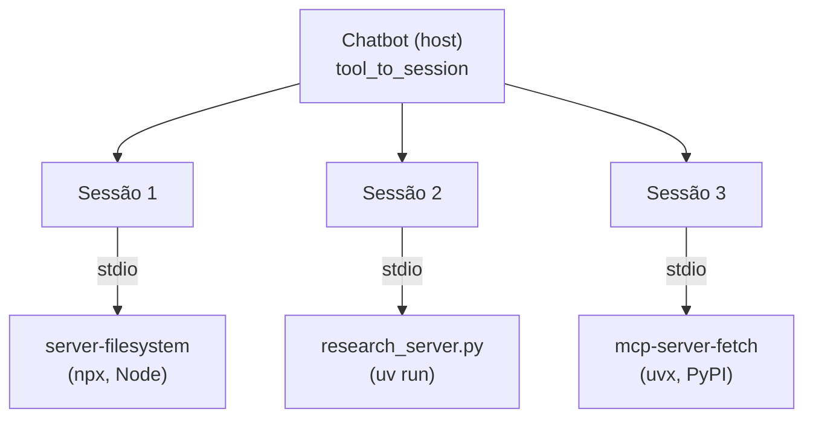

# 06 · Vários servidores

Um host pode abrir **uma sessão por servidor**. O LLM vê uma lista única de tools; o host sabe para qual servidor mandar cada chamada.



## Configuração em JSON

```json
{
  "mcpServers": {
    "filesystem": { "command": "npx", "args": ["-y", "@modelcontextprotocol/server-filesystem", "./workspace"] },
    "research":   { "command": "uv",  "args": ["run", "research_server.py"] },
    "fetch":      { "command": "uvx", "args": ["mcp-server-fetch"] }
  }
}
```

O formato `mcpServers` **não faz parte da spec**, mas virou padrão de fato: é o mesmo do Claude Desktop, do Cursor e de outros hosts. As chaves `command`/`args`/`env` batem com o `StdioServerParameters`.

| Comando | O que faz |
|---|---|
| `uv run arquivo.py` | Roda um arquivo Python local |
| `uvx pacote` | Baixa e roda um pacote Python do PyPI num ambiente isolado |
| `npx -y pacote` | Baixa e roda um pacote Node do npm |

## `available_tools` × `tool_to_session`

```python
# available_tools: a soma das tools de todos os servidores → vai para o Claude
[{"name": "read_file", ...}, {"name": "search_papers", ...}, {"name": "fetch", ...}]

# tool_to_session: nome → sessão → fica no chatbot, o Claude nunca vê
{"read_file": <sessão filesystem>, "search_papers": <sessão research>, "fetch": <sessão fetch>}
```

Exemplo: *"Leia deeplearning.ai, escolha um tema, busque 2 artigos e salve em results.txt"*

```
fetch(url=...)             → tool_to_session["fetch"]          → fetch
search_papers(topic=...)   → tool_to_session["search_papers"]  → research
write_file(path=...)       → tool_to_session["write_file"]     → filesystem
```

## `AsyncExitStack`

Com N servidores, N blocos `async with` aninhados ficam inviáveis. O `AsyncExitStack` empilha as conexões dinamicamente e fecha tudo na ordem inversa no `cleanup()`:

```python
transport = await self.exit_stack.enter_async_context(stdio_client(params))
session = await self.exit_stack.enter_async_context(ClientSession(*transport))
# ...
await self.exit_stack.aclose()   # no finally
```

## Servidores remotos na mesma lista

Para misturar servidores locais e remotos (ex.: o MCP do Miro, `https://mcp.miro.com/`), basta tratar entradas com `url`:

```python
if "url" in config:
    read, write, _ = await stack.enter_async_context(streamablehttp_client(config["url"]))
else:
    read, write = await stack.enter_async_context(stdio_client(StdioServerParameters(**config)))
```

Servidores remotos costumam exigir **OAuth**, o que é bem mais trabalhoso num cliente próprio. Para testar, um host pronto como o Claude Code resolve o login sozinho.

## Cuidados

- **Nomes repetidos:** duas tools com o mesmo nome sobrescrevem o `tool_to_session` e a API rejeita a lista. Solução: prefixar (`research__search_papers`).
- **Segurança:** se o `filesystem` recebe a pasta do projeto, ele enxerga o `.env`. Com o `fetch` junto, uma página maliciosa pode tentar instruir o modelo a ler e vazar a chave (*prompt injection*). Dê ao `filesystem` só uma subpasta.
- **Custo:** todas as tools vão em toda chamada ao LLM. Conecte só o necessário.
