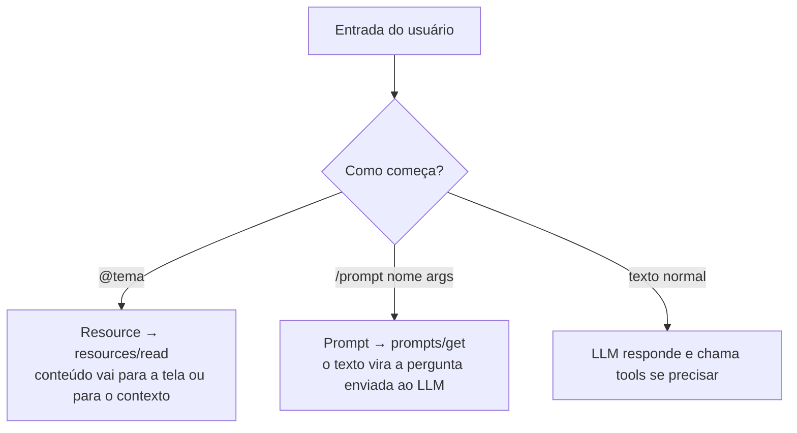

# 07 · Resources e prompts

## Quem aciona cada primitiva



| Primitiva | Quem decide | Exemplo |
|---|---|---|
| Tool | O LLM | Claude decide chamar `extract_info` |
| Resource | Usuário / app | `@ai_interpretability` mostra os artigos salvos |
| Prompt | Usuário | `/prompt generate_search_prompt topic=history` |

O uso de `@` e `/` é **convenção de interface**: a spec não define como o usuário aciona cada primitiva; cada host escolhe.

## Resources

```python
@mcp.resource("papers://folders")          # URI estática → aparece em resources/list
def listar_temas() -> str: ...

@mcp.resource("papers://{topic}")          # template → aparece em resources/templates/list
def artigos_do_tema(topic: str) -> str: ...
```

- Resources são **somente leitura**, como um GET: sem efeitos colaterais.
- O esquema da URI (`papers://`) é livre; o importante é ser único.

## Prompts

```python
@mcp.prompt()
def generate_search_prompt(topic: str, num_papers: int = 5) -> str:
    """Prompt to find and discuss papers on a topic."""
    return f"Use search_papers to find {num_papers} papers about '{topic}', then ..."
```

Nome, argumentos e descrição vêm da função, como nas tools.

## Mensagens no transporte

| Momento | Método |
|---|---|
| Conexão | `resources/list`, `resources/templates/list`, `prompts/list` |
| `@tema` | `resources/read` com `{"uri": "papers://tema"}` |
| `/prompt ...` | `prompts/get` com `{"name": ..., "arguments": {...}}` |

Os argumentos de prompt trafegam sempre como **texto** (`"2"`, não `2`).

## Cuidados

- Se o host só imprime o resource na tela, **o LLM não vê o conteúdo**. Para usar como contexto, anexe à pergunta.
- Antes de usar `/prompt`, liste com `/prompts` para pegar o nome exato.
