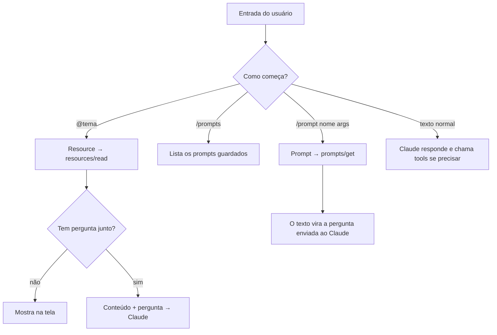
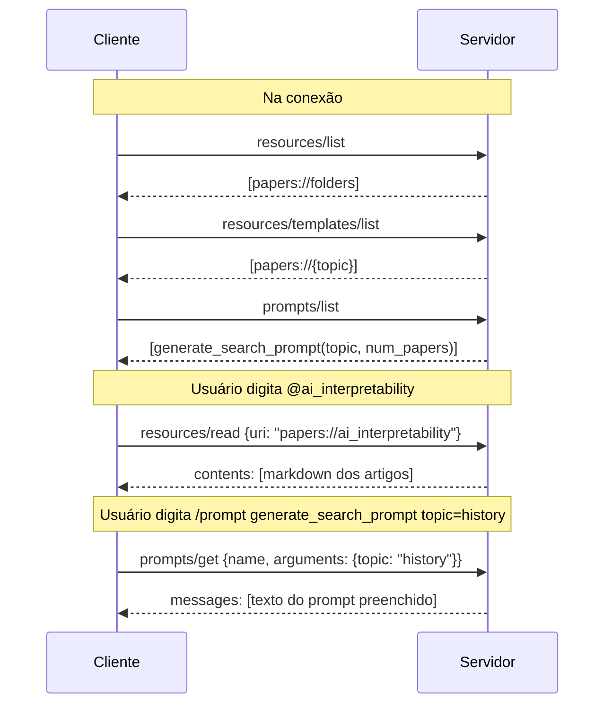

# 07 · Resources e prompts

> **Nesta nota:** as outras duas primitivas do servidor, quem aciona cada uma, URIs estáticas e templates, como o host descobre e usa resources e prompts, e as mensagens no protocolo.

## 1. Quem aciona cada primitiva

Esta é a ideia central:

| Primitiva | Quem decide usar | Analogia | Exemplo |
|---|---|---|---|
| **Tool** | O **LLM** | Uma função que o modelo chama | O Claude decide chamar `extract_info` |
| **Resource** | O **usuário** ou a **aplicação** | Um GET de API REST: só leitura | `@ai_interpretability` mostra os artigos salvos |
| **Prompt** | O **usuário** | Um atalho com um prompt bem escrito | `/prompt generate_search_prompt topic=history` |

O mesmo tema, nas três formas:

- **Tool:** você pergunta "quais artigos tenho sobre interpretabilidade?" e o Claude decide chamar `extract_info`.
- **Resource:** você digita `@ai_interpretability` e o conteúdo aparece direto, sem passar pelo Claude.
- **Prompt:** você digita `/prompt generate_search_prompt topic=history num_papers=2`. O servidor devolve um texto grande e bem estruturado, que vai ao Claude como se você o tivesse digitado.



O uso de `@` e `/` é **convenção de interface**: a especificação não define como o usuário aciona cada primitiva. Cada host escolhe (o Claude Code também usa `@` e `/`; o Claude Desktop usa um menu).

## 2. Resources

Resources são **dados somente leitura** identificados por uma URI. Devem se comportar como um GET: sem processamento pesado e sem efeitos colaterais.

### URI estática

```python
@mcp.resource("papers://folders")
def get_available_folders() -> str:
    """List all topic folders that have saved papers."""
    ...
    return "# Available topics\n\n- ai_interpretability\n- llm_reasoning\n"
```

Aparece em `resources/list`.

### Template (URI com parâmetro)

```python
@mcp.resource("papers://{topic}")
def get_topic_papers(topic: str) -> str:
    """Get the saved papers for a specific topic, formatted as markdown."""
    ...
```

Aparece em **`resources/templates/list`** (não em `resources/list`). O cliente preenche o `{topic}` na hora: `papers://ai_interpretability`.

O esquema da URI (`papers://`) é **livre**; o importante é ser único. Poderia ser `pesquisa://`, `file://`, `db://`.

### Exemplos de bons resources

- Conteúdo de um arquivo de configuração.
- Lista de tabelas de um banco.
- O schema de uma API.
- Os artigos salvos de um tema (como aqui).

## 3. Prompts

Um prompt é um **template de instrução** que o servidor oferece pronto. Útil quando escrever um bom prompt exige conhecimento do domínio: quem fez o servidor sabe melhor como pedir as coisas.

```python
@mcp.prompt()
def generate_search_prompt(topic: str, num_papers: int = 5) -> str:
    """Generate a prompt to find and discuss academic papers on a topic."""
    return (
        f"Use the search_papers tool to find {num_papers} papers about '{topic}'. "
        "Then, for each paper, use extract_info and summarize: title, authors, date, "
        "main contribution and method. Finish with an overview of the research "
        f"landscape in '{topic}'. Use headings and bullet points."
    )
```

Nome, argumentos e descrição vêm da função, como nas tools.

## 4. Descoberta e uso no protocolo



```json
// prompts/get: os argumentos SEMPRE trafegam como texto
{"method": "prompts/get",
 "params": {"name": "generate_search_prompt",
            "arguments": {"topic": "history", "num_papers": "2"}}}
```

Repare no `"2"` entre aspas: a especificação define argumentos de prompt como strings. O FastMCP converte para `int` antes de chamar a função.

## 5. No chatbot

```python
# Na conexão, além das tools:
for r in (await session.list_resources()).resources:
    self.resource_to_session[str(r.uri)] = session
for t in (await session.list_resource_templates()).resourceTemplates:
    self.template_schemes.append((t.uriTemplate.split("://")[0], session))
for p in (await session.list_prompts()).prompts:
    self.prompts[p.name] = {"session": session, "args": [a.name for a in p.arguments]}

# Usuário digitou "@ai_interpretability resuma"
content = await session.read_resource("papers://ai_interpretability")
await self.process_query(f"{content}\n\n---\n\nresuma")

# Usuário digitou "/prompt generate_search_prompt topic=history"
result = await session.get_prompt("generate_search_prompt", arguments={"topic": "history"})
await self.process_query(result.messages[0].content.text)
```

Resources e prompts são **opcionais**: nem todo servidor oferece. Por isso, no código, essas listagens ficam num `try/except`.

## 6. Cuidados

- **Se o host só imprime o resource na tela, o LLM não vê o conteúdo.** Para usar como contexto, anexe à pergunta (o `mcp_chatbot.py` deste repositório faz isso com `@tema pergunta`).
- **Liste antes de usar.** Rode `/prompts` para pegar o nome exato; nomes de exemplos em tutoriais nem sempre batem com o código.
- **Resource não é tool.** Se algo altera estado (salvar, enviar, apagar), é tool, não resource.

## 7. Obrigatório × convenção

| Parte | Nível |
|---|---|
| `@mcp.resource(uri)` e `@mcp.prompt()` | Obrigatório (FastMCP) |
| Estática em `resources/list`, template em `resources/templates/list` | Especificação |
| Esquema da URI (`papers://`) | Livre |
| Argumentos de prompt como texto | Especificação |
| `@` e `/` | Convenção de interface de cada host |
| Resource só impresso × usado como contexto | Decisão do host |

## Para fixar

1. Onde aparece um resource com URI `papers://{topic}`: em `resources/list` ou `resources/templates/list`?
2. Qual a diferença entre um prompt MCP e uma tool, em relação a quem decide usar?
3. Uma operação que salva um arquivo deve ser resource ou tool?

<details><summary>Respostas</summary>

1. Em `resources/templates/list`, porque tem um parâmetro.
2. O prompt é escolhido pelo usuário; a tool é escolhida pelo LLM.
3. Tool: resources são somente leitura e não devem ter efeitos colaterais.

</details>
