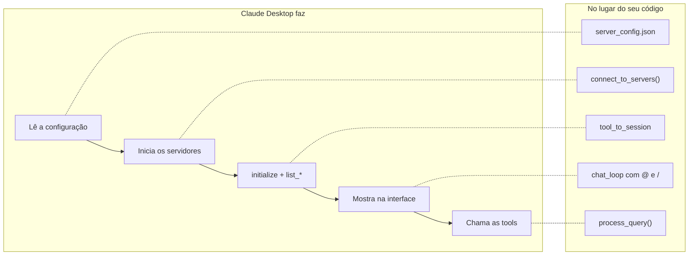

# 08 · Claude Desktop

O Claude Desktop faz sozinho tudo o que o chatbot das notas anteriores fazia em código. Você só escreve a configuração.



## Passo a passo

1. **Settings → Developer → Edit Config**.
2. Cole a configuração (caminhos **absolutos**):

```json
{
  "mcpServers": {
    "research": {
      "command": "uv",
      "args": ["--directory", "/Users/voce/mcp-estudos/codigo", "run", "research_server.py"]
    },
    "fetch": {
      "command": "uvx",
      "args": ["mcp-server-fetch"]
    }
  }
}
```

3. **Feche e abra** o app (a configuração só é lida ao iniciar).

| Sistema | Arquivo |
|---|---|
| macOS | `~/Library/Application Support/Claude/claude_desktop_config.json` |
| Windows | `%APPDATA%\Claude\claude_desktop_config.json` |

O `--directory` faz o servidor rodar de dentro da pasta do projeto, o que também resolve caminhos relativos no código.

## Problemas comuns

| Sintoma | Causa | Solução |
|---|---|---|
| `spawn uv ENOENT` | O app não enxerga o PATH do terminal | Use o caminho completo (`which uv`) no `command` |
| Servidor conecta e cai / erro de parse | `print()` no stdout | `print(..., file=sys.stderr)` |
| Nada aparece | JSON inválido (vírgula sobrando) | Valide o JSON |
| Não sei o que deu errado | — | Logs em `~/Library/Logs/Claude/mcp-server-<nome>.log` (macOS) |

> Servidores **remotos** (por URL) não entram nesse arquivo, que é para stdio. Eles são adicionados pela área de conectores do app.
