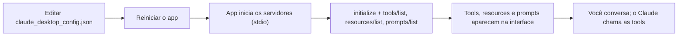

# 08 · Claude Desktop

> **Nesta nota:** como conectar os mesmos servidores ao Claude Desktop só com um arquivo de configuração, o que ele faz por você, onde ficam os arquivos e como resolver os problemas mais comuns.

## 1. O que o Claude Desktop faz por você

Tudo o que o chatbot das notas 05 a 07 fazia em código, o Claude Desktop faz sozinho. Você só escreve a configuração.

| O Claude Desktop… | No lugar do seu… |
|---|---|
| Lê `claude_desktop_config.json` | `server_config.json` |
| Inicia cada servidor como subprocesso (stdio) | `connect_to_servers()` + `exit_stack` |
| Faz `initialize` e lista tools, resources e prompts | `tool_to_session`, `list_prompts` |
| Mostra resources e prompts na interface | `chat_loop` com `@` e `/` |
| Conversa e chama as tools quando precisa | `process_query()` |



Entender o código "de baixo nível" das notas anteriores continua valendo: é exatamente isso que acontece por dentro.

## 2. Passo a passo

1. Prepare o projeto do servidor (`uv sync` ou `uv add "mcp>=1.10,<2" arxiv`).
2. No Claude Desktop: **Settings → Developer → Edit Config**.
3. Cole a configuração, com **caminhos absolutos**:

```json
{
  "mcpServers": {
    "research": {
      "command": "uv",
      "args": ["--directory", "/Users/voce/mcp-estudos/codigo", "run", "research_server.py"]
    },
    "fetch": {
      "command": "uvx",
      "args": ["mcp-server-fetch"]
    },
    "filesystem": {
      "command": "npx",
      "args": ["-y", "@modelcontextprotocol/server-filesystem", "/Users/voce/mcp-estudos/codigo/workspace"]
    }
  }
}
```

4. **Feche e abra** o app (a configuração só é lida ao iniciar).
5. Confira as tools no menu de ferramentas da conversa.

| Sistema | Onde fica o arquivo |
|---|---|
| macOS | `~/Library/Application Support/Claude/claude_desktop_config.json` |
| Windows | `%APPDATA%\Claude\claude_desktop_config.json` |

### Por que `--directory`

O Claude Desktop não inicia os servidores de dentro da pasta do seu projeto. O `uv --directory <pasta>` faz o servidor rodar de lá, o que resolve:
- encontrar o `pyproject.toml` e o ambiente certo;
- caminhos relativos no código (como uma pasta `papers/`).

## 3. Variáveis de ambiente

Servidores que precisam de chave de API recebem pelo campo `env`, nunca no código:

```json
"meu-servidor": {
  "command": "uv",
  "args": ["--directory", "/caminho", "run", "server.py"],
  "env": { "MINHA_API_KEY": "..." }
}
```

## 4. Exemplo de uso

Com `fetch` e `research` conectados, o pedido do curso:

> "Visite deeplearning.ai, encontre um tema interessante de machine learning, busque 2 artigos sobre ele, resuma os principais pontos e crie um quiz com flashcards."

O Claude combina as tools: `fetch` para ler o site, `search_papers` e `extract_info` para os artigos, e um artifact para o quiz (artifacts são um recurso do próprio Claude, não do MCP).

## 5. Problemas comuns

| Sintoma | Causa provável | Solução |
|---|---|---|
| Erro `spawn uv ENOENT` | O app não enxerga o mesmo PATH do terminal | Use o caminho completo: `which uv` (Windows: `where uv`) e coloque o resultado no `command` |
| O servidor conecta e cai, ou dá erro de parse | `print()` no stdout | `print(..., file=sys.stderr)` ou `logging` |
| Nenhum servidor aparece | JSON inválido (vírgula sobrando no fim de uma lista) | Valide o JSON antes de reiniciar |
| Tools aparecem, mas falham ao gravar arquivos | Caminho relativo no código | `--directory` ou caminho absoluto a partir de `__file__` |
| `ModuleNotFoundError: mcp.server.fastmcp` | O SDK instalado é o v2 | Fixe `mcp<2` ou migre |
| Não sei o que deu errado | — | Veja os logs: no macOS, `~/Library/Logs/Claude/mcp-server-<nome>.log` (tudo que o servidor manda para o stderr aparece lá) |

## 6. Servidores remotos

O `claude_desktop_config.json` é para servidores **stdio** (com `command`). Servidores remotos (por URL, como o do Miro) são adicionados pela área de **conectores** do app, que também cuida do login OAuth.

## 7. Outros hosts

O mesmo servidor funciona em qualquer host compatível com MCP: IDEs (como Cursor e VS Code), o Claude Code (linha de comando), frameworks de agentes. A documentação oficial do MCP mantém uma lista de clientes e de quais primitivas cada um suporta. A configuração costuma usar o mesmo formato `mcpServers`.

## Para fixar

1. Por que é preciso reiniciar o Claude Desktop depois de editar a configuração?
2. Por que caminhos relativos costumam falhar no Claude Desktop?
3. Onde procurar o erro quando um servidor não conecta?

<details><summary>Respostas</summary>

1. Porque o app só lê o arquivo ao iniciar.
2. Porque o app não inicia o servidor de dentro da pasta do projeto, então "papers/" aponta para outro lugar.
3. Nos logs do servidor (no macOS, `~/Library/Logs/Claude/mcp-server-<nome>.log`).

</details>
