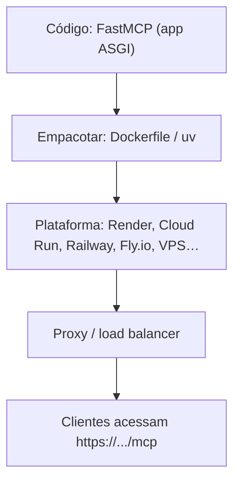

# 09 · Servidores remotos e deploy

> **Nesta nota:** como transformar o servidor local num servidor remoto, como conectar clientes a ele, como publicar na nuvem como uma API comum e os cuidados de produção.

## 1. Local × remoto

| | Local (stdio) | Remoto (Streamable HTTP) |
|---|---|---|
| Quem inicia | O cliente, como subprocesso | Você ou a nuvem, **antes** do cliente conectar |
| Onde roda | Na máquina do host | Em qualquer lugar acessível por URL |
| Clientes | 1 por processo | Vários ao mesmo tempo |
| Como o cliente acha | `command` + `args` | URL (`https://.../mcp`) |
| Autenticação | Variáveis de ambiente | OAuth 2.1 (recomendado) |

## 2. Mudando o transporte

As tools, resources e prompts **não mudam**. Só a última linha:

```python
mcp.run(transport="stdio")             # local
mcp.run(transport="streamable-http")   # remoto: http://localhost:8000/mcp
mcp.run(transport="sse")               # remoto legado: http://localhost:8000/sse (evite)
```

Neste repositório, o mesmo arquivo serve para os dois casos:

```bash
uv run research_server.py                       # stdio
MCP_TRANSPORT=http uv run research_server.py    # Streamable HTTP em :8000/mcp
```

### Stateful × stateless (SDK v1)

```python
mcp = FastMCP("research")                        # stateful: guarda a sessão de cada cliente
mcp = FastMCP("research", stateless_http=True)   # stateless: cada requisição é independente
```

| | Stateful | Stateless |
|---|---|---|
| Lembra o cliente entre requisições | Sim (sessão com `Mcp-Session-Id`) | Não |
| Várias instâncias atrás de um load balancer | Precisa de sticky session | Funciona direto |
| Quando usar | Fluxos que dependem de estado | Tools independentes (como as deste projeto) |

> **Atualização:** Na spec 2026-07-28, o próprio protocolo ficou stateless (sem sessões), então essa escolha deixa de existir. Ver [nota 10](10-alem-do-basico.md).

## 3. Testando localmente

Um servidor remoto precisa **já estar rodando** antes de o cliente conectar. Use dois terminais:

```bash
# Terminal 1: o servidor (deixe aberto)
MCP_TRANSPORT=http uv run research_server.py

# Terminal 2: o Inspector, apontando para a URL
npx @modelcontextprotocol/inspector
# na interface: Transport Type = Streamable HTTP, URL = http://localhost:8000/mcp
```

## 4. Conectando um cliente

```python
from mcp import ClientSession
from mcp.client.streamable_http import streamablehttp_client

async with streamablehttp_client("http://localhost:8000/mcp") as (read, write, _):   # 3 valores!
    async with ClientSession(read, write) as session:
        await session.initialize()
        tools = (await session.list_tools()).tools
```

O terceiro valor é uma função que devolve o ID da sessão. Tutoriais que fazem `read, write = ...` quebram com "too many values to unpack".

Para o SSE legado: `from mcp.client.sse import sse_client` e `sse_client(url=".../sse")`, que devolve 2 valores.

No chatbot multi-servidor, basta uma entrada com `url` no `server_config.json` (ver [nota 06](06-varios-servidores.md)).

## 5. Publicando: é como subir uma API

Por baixo, o FastMCP monta um app **ASGI** (Starlette, a mesma base do FastAPI) servido pelo uvicorn. Você publica como publicaria qualquer API Python.



### O servidor pronto para deploy

```python
import os
from mcp.server.fastmcp import FastMCP

mcp = FastMCP(
    "research",
    host="0.0.0.0",                            # aceita conexões de fora
    port=int(os.environ.get("PORT", 8000)),    # porta definida pela plataforma
    stateless_http=True,                       # qualquer instância atende qualquer requisição
)
```

### Dockerfile

```dockerfile
FROM python:3.12-slim
COPY --from=ghcr.io/astral-sh/uv:latest /uv /usr/local/bin/uv
WORKDIR /app
COPY pyproject.toml uv.lock ./
RUN uv sync --frozen --no-dev
COPY . .
ENV MCP_TRANSPORT=http
CMD ["uv", "run", "research_server.py"]
```

### Exemplo: Render

1. Suba o código para o GitHub.
2. No Render: **New → Web Service** → escolha o repositório.
3. Runtime Docker (com o Dockerfile acima) ou Python com start command `MCP_TRANSPORT=http uv run research_server.py`.
4. A URL fica `https://seu-app.onrender.com/mcp`.

## 6. Cuidados de produção

| Ponto | Por quê | O que fazer |
|---|---|---|
| Host padrão `127.0.0.1` | Só aceita conexões da própria máquina | `host="0.0.0.0"` |
| Porta | A plataforma define via `PORT` | Ler `os.environ["PORT"]` |
| Proxy com buffer | Eventos SSE chegam todos juntos no fim | No nginx: `proxy_buffering off;` e timeout maior |
| Várias instâncias (SDK v1) | A sessão fica na memória de uma instância | `stateless_http=True` ou sticky session |
| Disco temporário | Arquivos (como `papers/`) somem a cada deploy ou reinício | Banco de dados ou armazenamento externo |
| URL pública | Qualquer um pode chamar as suas tools | Autenticação (OAuth 2.1) |
| Validação de `Origin` | Proteção contra DNS rebinding | O SDK faz; não desligue |
| Health check | `/mcp` não responde a um GET simples | Criar uma rota `/health` |
| Plano gratuito "dorme" | A primeira conexão depois de um tempo parado demora | Plano pago ou aceitar o atraso |
| `/mcp/` com barra | Pode gerar redirecionamento e falhar em alguns clientes | Use `/mcp` |

## 7. Montando dentro de uma API existente

Como é um app ASGI, dá para montar o MCP dentro de um app FastAPI:

```python
import contextlib
from fastapi import FastAPI
from research_server import mcp

@contextlib.asynccontextmanager
async def lifespan(app):
    async with mcp.session_manager.run():   # obrigatório ao montar o app MCP
        yield

app = FastAPI(lifespan=lifespan)
app.mount("/", mcp.streamable_http_app())   # MCP responde em /mcp

@app.get("/health")
def health():
    return {"ok": True}
```

Sem o `session_manager.run()` no `lifespan`, as requisições ao `/mcp` falham.

## 8. No SDK v2

Na v2, opções de transporte como `host`, `port`, `stateless_http` e `json_response` saem do construtor e passam para o `streamable_http_app()`. Ou seja, `FastMCP("research", port=8001)` não funciona igual. Ver [SDK v1 × v2](sdk-v1-vs-v2.md).

## Para fixar

1. Por que um servidor remoto precisa estar rodando antes do cliente conectar?
2. O que acontece se você publicar o servidor com o host padrão `127.0.0.1`?
3. Por que a pasta `papers/` some num deploy no plano gratuito?

<details><summary>Respostas</summary>

1. Porque, diferente do stdio, o cliente não inicia o servidor: ele só se conecta a uma URL.
2. O servidor só aceita conexões da própria máquina; ninguém de fora consegue acessar.
3. Porque o disco desses ambientes é temporário e é recriado a cada deploy ou reinício.

</details>
