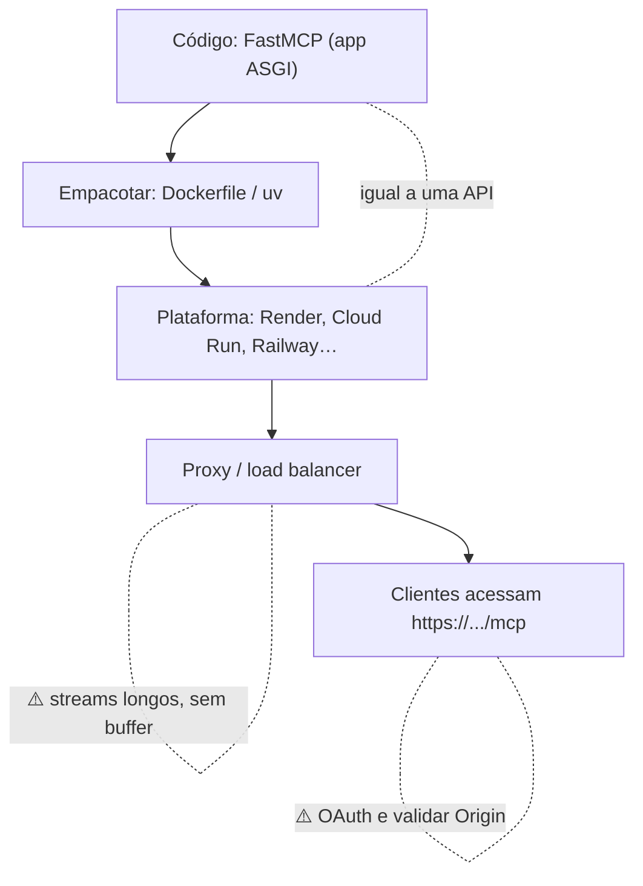

# 09 · Servidores remotos e deploy

Um servidor MCP remoto é uma **aplicação web comum**: por baixo, o FastMCP monta um app ASGI (Starlette, a mesma base do FastAPI). Você publica como publicaria uma API, com alguns cuidados.



## Servidor pronto para deploy (SDK v1)

```python
import os
from mcp.server.fastmcp import FastMCP

mcp = FastMCP(
    "research",
    host="0.0.0.0",                            # aceita conexões externas
    port=int(os.environ.get("PORT", 8000)),    # porta definida pela plataforma
    stateless_http=True,                       # qualquer instância atende qualquer requisição
)

# ... tools, resources e prompts ...

if __name__ == "__main__":
    mcp.run(transport="streamable-http")       # não use o "sse" antigo em projetos novos
```

```dockerfile
FROM python:3.12-slim
COPY --from=ghcr.io/astral-sh/uv:latest /uv /usr/local/bin/uv
WORKDIR /app
COPY pyproject.toml uv.lock ./
RUN uv sync --frozen --no-dev
COPY . .
CMD ["uv", "run", "research_server.py"]
```

## Conectando um cliente

```python
from mcp.client.streamable_http import streamablehttp_client

read, write, _ = await stack.enter_async_context(        # devolve 3 valores!
    streamablehttp_client("https://seu-app.onrender.com/mcp"))
session = await stack.enter_async_context(ClientSession(read, write))
```

## Cuidados que uma API comum não costuma ter

| Ponto | Por quê | O que fazer |
|---|---|---|
| Host padrão `127.0.0.1` | Só aceita conexões da própria máquina | `host="0.0.0.0"` |
| Porta | A plataforma define via `PORT` | Ler `os.environ["PORT"]` |
| Proxy com buffer | Eventos SSE chegam todos juntos no fim | No nginx: `proxy_buffering off;` e timeout maior |
| Várias instâncias (SDK v1) | A sessão fica na memória de uma instância | `stateless_http=True` ou sticky session |
| Disco temporário | Arquivos somem a cada deploy/reinício | Banco ou armazenamento externo |
| URL pública | Qualquer um chama as tools | Autenticação (OAuth 2.1) |
| Health check | `/mcp` não responde a um GET simples | Criar uma rota `/health` |

> 🆕 Na spec **2026-07-28**, o protocolo ficou stateless (sem handshake e sem `Mcp-Session-Id`), então o problema de várias instâncias deixa de existir no próprio protocolo. No SDK v2, opções como `host`, `port` e `stateless_http` saem do construtor. Veja [SDK v1 × v2](sdk-v1-vs-v2.md).

## Montando dentro de uma API existente

```python
import contextlib
from fastapi import FastAPI
from research_server import mcp

@contextlib.asynccontextmanager
async def lifespan(app):
    async with mcp.session_manager.run():   # obrigatório ao montar o app MCP
        yield

app = FastAPI(lifespan=lifespan)
app.mount("/", mcp.streamable_http_app())   # MCP responde em /mcp

@app.get("/health")
def health():
    return {"ok": True}
```
