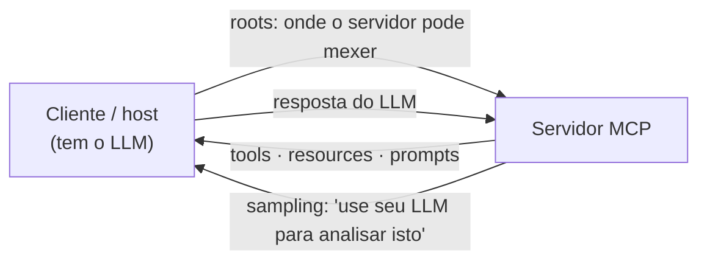
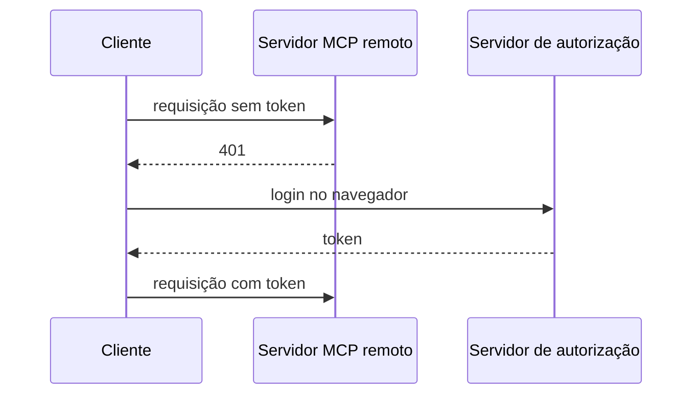
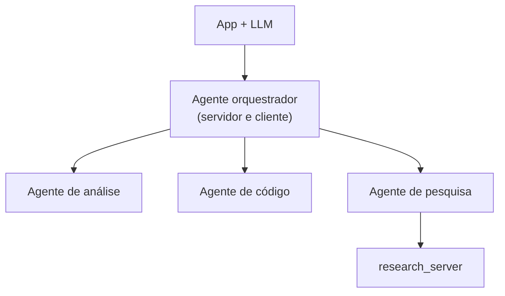

# 10 · Além do básico

## A comunicação nos dois sentidos

## OAuth 2.1

Para servidores **remotos**. Com stdio, credenciais vão por variável de ambiente.

Exemplo real: o MCP oficial do Miro (`https://mcp.miro.com/`) usa Streamable HTTP + OAuth.

## Roots

O cliente informa as URIs em que o servidor deve trabalhar, por exemplo `file:///Users/voce/projeto`. Traz **segurança** (limita o acesso) e **foco**. É a versão formal de passar uma pasta como argumento ao servidor `filesystem`.

## Sampling

O servidor pede uma inferência **ao LLM do cliente**.

Exemplo: um servidor de monitoramento junta logs e métricas de um site lento e pede ao LLM um diagnóstico. Os dados pesados não precisam ir para o contexto da conversa, e o servidor não precisa ter um LLM nem uma chave de API própria: o custo fica no cliente.

## Arquitetura componível

Um agente pode ser **servidor** para quem está acima e **cliente** para quem está abaixo:

## Descoberta de servidores

- **Registry:** catálogo central de servidores, lançado em preview em setembro de 2025 em [registry.modelcontextprotocol.io](https://registry.modelcontextprotocol.io).
- **`.well-known`:** a ideia de um site publicar um JSON dizendo onde está o seu servidor MCP, quais capacidades ele tem e qual autenticação exige.

## 🆕 O que mudou na spec 2026-07-28

| Antes | Agora |
|---|---|
| Handshake `initialize` / `initialized` | Removido; existe um `server/discover` opcional |
| Header `Mcp-Session-Id` (sessões) | Removido: o núcleo do protocolo é stateless |
| Escalar exigia cuidado com sessões | Qualquer instância atende qualquer requisição |
| — | Headers `Mcp-Method` e `Mcp-Name` nas requisições HTTP |
| — | Extensões oficiais, como o MCP Apps (interfaces renderizadas pelo servidor) |
| OAuth recém-adicionado | Autenticação reforçada para cenários corporativos |

Fontes: [anúncio da spec 2026-07-28](https://blog.modelcontextprotocol.io/posts/2026-07-28/) · [MCP Registry](https://modelcontextprotocol.io/registry/about)
