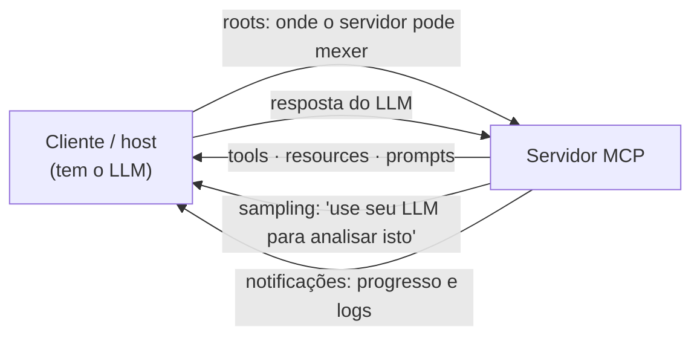
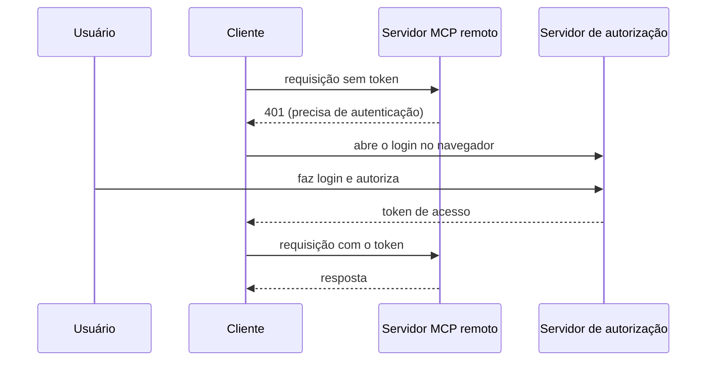
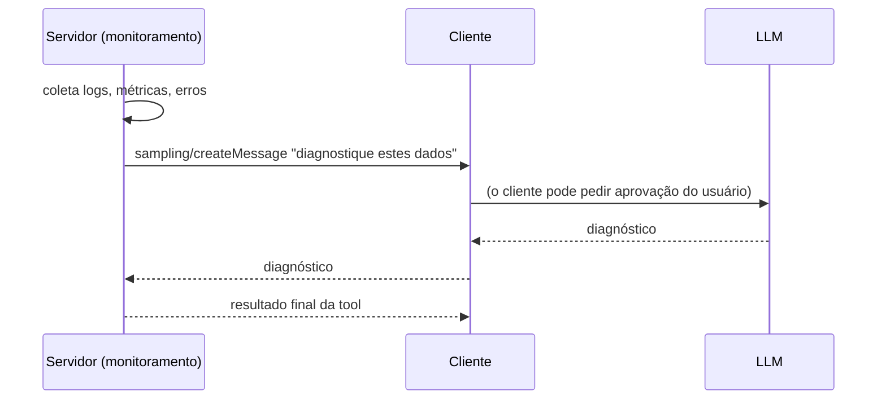
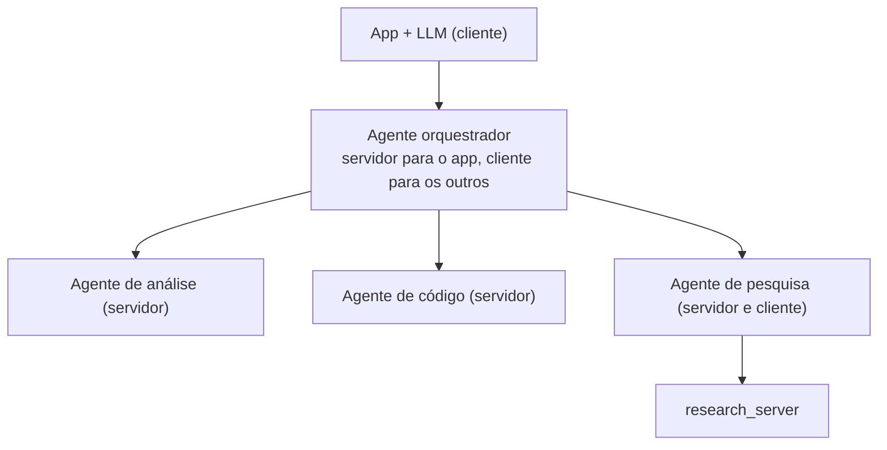

# 10 · Além do básico

> **Nesta nota:** autenticação com OAuth, as primitivas do cliente (roots e sampling), notificações de progresso e log, a arquitetura componível de agentes, a descoberta de servidores e o que mudou na spec 2026-07-28.

## 1. A comunicação nos dois sentidos

Até aqui, só o servidor oferecia coisas. Mas o cliente também pode oferecer:



## 2. OAuth 2.1

Adicionado na spec de março de 2025 (2025-03-26), para servidores **remotos**. Com stdio, as credenciais vão por variável de ambiente e não há necessidade de OAuth.



É opcional na especificação, mas **altamente recomendado** para qualquer servidor remoto. Exemplo real: o MCP oficial do Miro (`https://mcp.miro.com/`) usa Streamable HTTP com OAuth; hosts como o Claude Code abrem o login sozinhos.

## 3. Roots

O cliente informa ao servidor as URIs em que ele deve trabalhar:

```json
{"roots": [{"uri": "file:///Users/voce/projeto", "name": "Projeto atual"}]}
```

- **Segurança:** limita o que o servidor acessa.
- **Foco:** o servidor procura arquivos só onde importa.
- **Versatilidade:** normalmente caminhos de arquivo, mas pode ser qualquer URI válida, inclusive HTTP.

É a versão formal de passar uma pasta como argumento ao servidor `filesystem` (ver [nota 06](06-varios-servidores.md)).

## 4. Sampling

O servidor pede uma inferência **ao LLM do cliente** (método `sampling/createMessage`).

**Exemplo:** usuários reclamam que um site está lento. Um servidor de monitoramento coleta logs, métricas e erros e, em vez de devolver tudo isso ao cliente (enchendo o contexto da conversa), pede ao LLM um diagnóstico e devolve só o resultado.



Vantagens:
- **Custo e complexidade ficam no cliente:** o servidor não precisa de um LLM nem de chave de API própria.
- **Contexto mais limpo:** os dados pesados não entram na conversa.
- **Controle:** o cliente decide se aceita o pedido e qual modelo usar.

No SDK Python v1, um servidor FastMCP faz sampling pelo objeto de contexto (`ctx.session.create_message(...)`), e o cliente precisa registrar um `sampling_callback` para atender.

## 5. Notificações de progresso e log

Para tools demoradas, o servidor pode avisar o que está fazendo, em vez de deixar o usuário olhando um loading. No FastMCP, isso é feito pelo parâmetro `Context`:

```python
from mcp.server.fastmcp import Context

@mcp.tool()
async def processar_lote(arquivos: list[str], ctx: Context) -> str:
    """Process a batch of files."""
    for i, arquivo in enumerate(arquivos, start=1):
        await ctx.info(f"Processando {arquivo}")                 # notificação de log
        await ctx.report_progress(i, len(arquivos))               # notificação de progresso
        ...
    return "ok"
```

No Streamable HTTP, essas notificações chegam pelo stream SSE da resposta (ver [nota 02](02-transportes.md)). No cliente, elas são recebidas por callbacks (`logging_callback`, `message_handler`).

## 6. Arquitetura componível

Um agente pode ser **servidor** para quem está acima e **cliente** para quem está abaixo. Isso permite montar sistemas multiagente em que todos falam o mesmo protocolo:



Com sampling, os agentes de baixo podem pedir inferências ao LLM de cima, sem cada um precisar do seu próprio modelo.

## 7. Descoberta de servidores

### Registry

Um catálogo central de servidores, para descobrir, verificar e versionar servidores MCP, com um papel parecido com o do npm ou do PyPI. O registry oficial foi lançado em preview em setembro de 2025 em [registry.modelcontextprotocol.io](https://registry.modelcontextprotocol.io).

Por que importa: há dezenas de servidores para o mesmo serviço (GitHub, Google Drive…), e, como em qualquer gerenciador de pacotes, pode haver código malicioso. Um registry ajuda a saber quais são oficiais e confiáveis.

### `.well-known`

A ideia de um site publicar, num endereço conhecido, um JSON dizendo onde fica o seu servidor MCP, quais capacidades ele tem e qual autenticação exige. Assim, um agente que recebe "gerencie minha loja no Shopify" poderia descobrir sozinho como se conectar.

## 8. O que mudou na spec 2026-07-28

| Antes | Agora |
|---|---|
| Handshake `initialize` / `initialized` | Removido; existe um `server/discover` opcional |
| Header `Mcp-Session-Id` (sessões) | Removido: o núcleo do protocolo é **stateless** |
| Escalar exigia cuidado com sessões | Qualquer instância atende qualquer requisição atrás de um load balancer comum |
| — | Headers `Mcp-Method` e `Mcp-Name` nas requisições HTTP |
| — | Extensões oficiais, como o MCP Apps (interfaces renderizadas pelo servidor) |
| OAuth recém-adicionado | Autenticação reforçada para cenários corporativos |

```http
POST /mcp HTTP/1.1
MCP-Protocol-Version: 2026-07-28
Mcp-Method: tools/call
Mcp-Name: search_papers
```

O código destas notas usa o SDK v1 (modelo anterior). Os conceitos de tools, resources, prompts, transportes, roots e sampling continuam valendo.

## 9. Desafios em aberto

- **Colisão de nomes** entre tools de servidores diferentes (`buscar_usuarios` em dois servidores).
- **Agrupamento lógico** de servidores e tools.
- **Adoção de sampling** pelos clientes.
- **Autenticação e autorização em escala**.

Fontes: [anúncio da spec 2026-07-28](https://blog.modelcontextprotocol.io/posts/2026-07-28/) · [MCP Registry](https://modelcontextprotocol.io/registry/about) · [curso Model Context Protocol: Advanced Topics](https://anthropic.skilljar.com/model-context-protocol-advanced-topics)

## Para fixar

1. No sampling, quem paga pela inferência: o servidor ou o cliente?
2. Qual a diferença entre roots e o argumento de pasta passado ao `filesystem`?
3. O que a spec 2026-07-28 removeu que simplificou o deploy?

<details><summary>Respostas</summary>

1. O cliente: é o LLM dele que faz a inferência.
2. Roots são uma primitiva do protocolo: o cliente informa as URIs de forma padronizada, e o servidor pode consultá-las (`roots/list`). O argumento de pasta é só uma configuração específica daquele servidor.
3. O handshake e as sessões (`Mcp-Session-Id`): sem estado, qualquer instância atende qualquer requisição.

</details>
