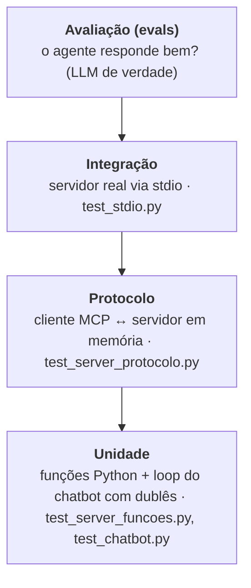
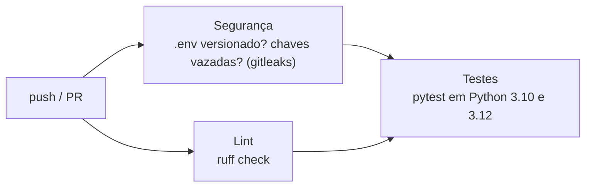
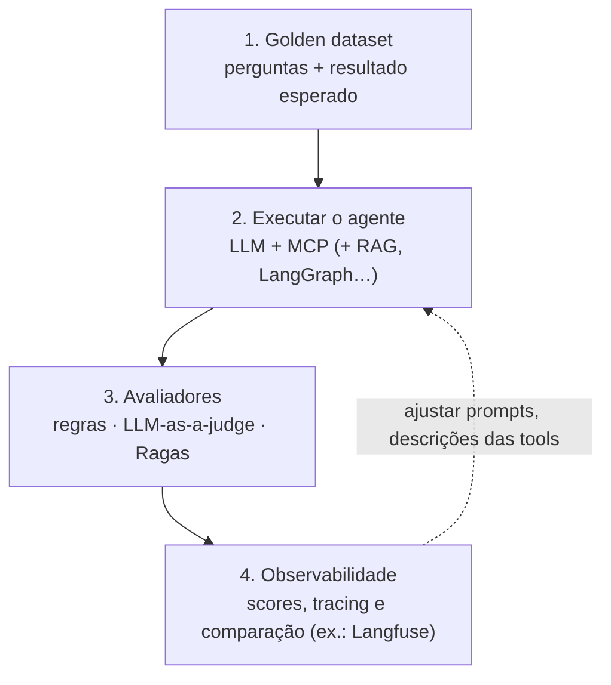

# 11 · Testando servidores e agentes MCP

> **Nesta nota:** como testar um servidor MCP e um chatbot que usa MCP, em camadas, sem depender de internet nem de chave de API, e como isso se conecta à avaliação (evals) de agentes.

## 1. A pirâmide de testes deste repositório



Quanto mais embaixo, mais rápido, mais barato e mais determinístico. Quanto mais em cima, mais parecido com o uso real.

| Camada | Pergunta que responde | Precisa de rede/LLM? | Tempo |
|---|---|---|---|
| Unidade | A lógica da minha função está certa? | Não | ms |
| Protocolo | O servidor fala MCP corretamente? | Não | ms |
| Integração | O servidor sobe e responde como subprocesso? | Não | ~1 s |
| Avaliação | O agente escolhe as tools certas e responde bem? | Sim | s a min |

```bash
cd codigo
uv run pytest -v          # roda as 3 primeiras camadas (36 testes, ~4 s)
```

## 2. Testes de unidade: as funções como Python comum

O decorador `@mcp.tool()` não muda a função: ela continua sendo chamável diretamente. Isso permite testar a lógica sem protocolo nenhum.

O arXiv é simulado com o `monkeypatch` do pytest, para os testes não dependerem de internet (e não ficarem lentos ou instáveis):

```python
@pytest.fixture
def fake_arxiv(monkeypatch):
    def fake_results(self, search):
        return [FakePaper(i) for i in range(1, search.max_results + 1)]
    monkeypatch.setattr(research_server.arxiv.Client, "results", fake_results)

def test_search_papers_devolve_ids(papers_dir, fake_arxiv):
    ids = rs.search_papers("LLM interpretability", max_results=3)
    assert ids == ["2601.00001v1", "2601.00002v1", "2601.00003v1"]
```

Um teste que vale ouro para servidores stdio: garantir que **nada vai para o stdout**.

```python
def test_search_papers_nao_escreve_no_stdout(papers_dir, fake_arxiv, capsys):
    rs.search_papers("llm", max_results=1)
    saida = capsys.readouterr()
    assert saida.out == ""                       # stdout limpo
    assert "Resultados salvos" in saida.err      # log foi para o stderr
```

## 3. Testes de protocolo: um cliente MCP de verdade, em memória

O SDK tem um utilitário que conecta um cliente e um servidor **no mesmo processo**, sem subprocesso nem rede. É o jeito mais rápido de testar o que o Inspector mostraria:

```python
from mcp.shared.memory import create_connected_server_and_client_session

@pytest.mark.anyio
async def test_tools_list_gera_schema_a_partir_da_funcao():
    async with create_connected_server_and_client_session(rs.mcp) as cliente:
        tools = {t.name: t for t in (await cliente.list_tools()).tools}

    schema = tools["search_papers"].inputSchema
    assert schema["required"] == ["topic"]                     # max_results tem padrão
    assert schema["properties"]["max_results"]["default"] == 5
```

O que vale testar nesta camada:

- O **schema** gerado (tipos, obrigatórios, descrições): é o que o LLM vai ler.
- `tools/call` com argumentos válidos **e inválidos** (falta de argumento deve voltar `isError: true`).
- Resources estáticos em `resources/list` e templates em `resources/templates/list`.
- `prompts/get` com argumentos como **texto** (`"2"`, não `2`), como a spec exige.

## 4. Teste de integração: o servidor de verdade via stdio

Sobe o `research_server.py` como subprocesso, exatamente como o Claude Desktop faria:

```python
async def test_servidor_responde_via_stdio():
    params = StdioServerParameters(command=sys.executable, args=[SERVIDOR])
    async with stdio_client(params) as (read, write):
        async with ClientSession(read, write) as sessao:
            init = await sessao.initialize()
            tools = [t.name for t in (await sessao.list_tools()).tools]
    assert init.serverInfo.name == "research"
    assert sorted(tools) == ["extract_info", "search_papers"]
```

Pega problemas que as outras camadas não pegam: erro de import, `print()` no stdout durante a inicialização, dependência faltando.

## 5. Testando o chatbot: dublês para o Claude e para as sessões

O loop do `process_query` é a parte mais delicada (lembra das [3 regras](03-tool-use.md)?). Para testá-lo sem gastar tokens, o Claude vira um **dublê** que devolve respostas prontas e guarda o que recebeu:

```python
class FakeClaude:
    def __init__(self, *respostas):
        self.respostas, self.chamadas, self.messages = list(respostas), [], self
    def create(self, **kwargs):
        self.chamadas.append({**kwargs, "messages": list(kwargs["messages"])})
        return NS(content=self.respostas.pop(0))

async def test_tools_em_paralelo_vao_numa_unica_mensagem(bot):
    bot.tool_to_session = {"search_papers": FakeSessao()}
    bot.anthropic = FakeClaude(
        [texto("Vou buscar."),
         tool_use("t1", "search_papers", {"topic": "ia"}),
         tool_use("t2", "search_papers", {"topic": "física"})],
        [texto("Pronto.")],
    )
    await bot.process_query("busque ia e física")

    segunda = bot.anthropic.chamadas[1]["messages"]
    assert [r["tool_use_id"] for r in segunda[2]["content"]] == ["t1", "t2"]
```

Cenários cobertos em `test_chatbot.py`:

| Cenário | Por que importa |
|---|---|
| Resposta só com texto | O loop termina na primeira volta |
| Uma tool | O `tool_result` usa o mesmo `tool_use_id` |
| Duas tools em paralelo | Os resultados vão juntos numa única mensagem |
| Vários blocos de texto | Não entra em loop infinito (bug do curso) |
| Várias rodadas | `search_papers` → `extract_info` → resposta |
| Tool com erro | `is_error` chega ao Claude |
| Vários servidores | Cada tool vai para a sessão certa |
| Tools repetidas | A segunda é ignorada, sem quebrar a lista |

## 6. Testes automáticos e guardrails no GitHub Actions

O arquivo `.github/workflows/testes.yml` roda a cada push na `main` e a cada pull request, em três etapas:



Os testes só rodam se a segurança e o lint passarem.

| Guardrail | O que evita |
|---|---|
| `permissions: contents: read` | O token do workflow não consegue alterar o repositório, mesmo se uma action for comprometida |
| Checagem de `.env` versionado | Subir sem querer o arquivo com a `ANTHROPIC_API_KEY` |
| gitleaks | Chaves e tokens colados no código ou em qualquer commit do histórico |
| ruff | Imports não usados, variáveis indefinidas e outros erros comuns |
| Matriz de versões do Python | Código que só funciona na versão da sua máquina |
| `timeout-minutes` | Um teste travado consumindo minutos do Actions |
| `concurrency` | Execuções duplicadas: um novo push cancela a anterior |
| Chave falsa no ambiente | Os testes nunca chamam a API real nem gastam tokens |
| Dependabot (`.github/dependabot.yml`) | Dependências e actions desatualizadas, inclusive com falhas de segurança |

O selo no topo do README mostra se tudo está passando.

## 7. O próximo nível: avaliação (evals) de agentes

Testes garantem que o **código** funciona. Mas não dizem se o **agente** escolhe a tool certa, passa os argumentos certos e responde bem, porque isso depende do LLM, que não é determinístico. Para isso existem as **avaliações**:



1. **Golden dataset:** um conjunto de perguntas com o que se espera, por exemplo:
   ```json
   {"pergunta": "Busque 2 artigos sobre RAG",
    "tools_esperadas": ["search_papers"],
    "argumentos_esperados": {"topic": "RAG", "max_results": 2}}
   ```
2. **Executar o agente** com o LLM de verdade e registrar tudo: tools chamadas, argumentos, resposta final.
3. **Avaliadores:**
   - **regras** (determinísticas): chamou `search_papers`? com `max_results=2`?
   - **LLM-as-a-judge:** outro LLM dá nota à resposta (está correta? completa? cita os artigos?);
   - **métricas de RAG** (ex.: Ragas): fidelidade ao contexto, relevância da resposta.
4. **Observabilidade:** guardar os scores e o *trace* de cada execução numa ferramenta como o Langfuse, para comparar versões (mudei a descrição da tool, o agente melhorou ou piorou?).

Uma descoberta comum nas evals: muitas falhas de agentes vêm de **descrições ruins das tools**. Como a docstring vira a descrição (ver [nota 04](04-servidor.md)), melhorar a docstring é muitas vezes a correção mais barata.

## Para fixar

1. Por que simular o arXiv nos testes em vez de chamar a API de verdade?
2. Que tipo de problema só o teste de integração via stdio consegue pegar?
3. Um teste com `FakeClaude` garante que o agente vai escolher a tool certa em produção?

<details><summary>Respostas</summary>

1. Para os testes serem rápidos, determinísticos e funcionarem sem internet (inclusive no CI).
2. Problemas na inicialização do processo: erro de import, dependência faltando, `print()` no stdout ao subir.
3. Não. Ele garante que o **código** trata corretamente as respostas do Claude. Se o Claude escolhe a tool certa é uma questão de **avaliação**, com o LLM real e um golden dataset.

</details>
