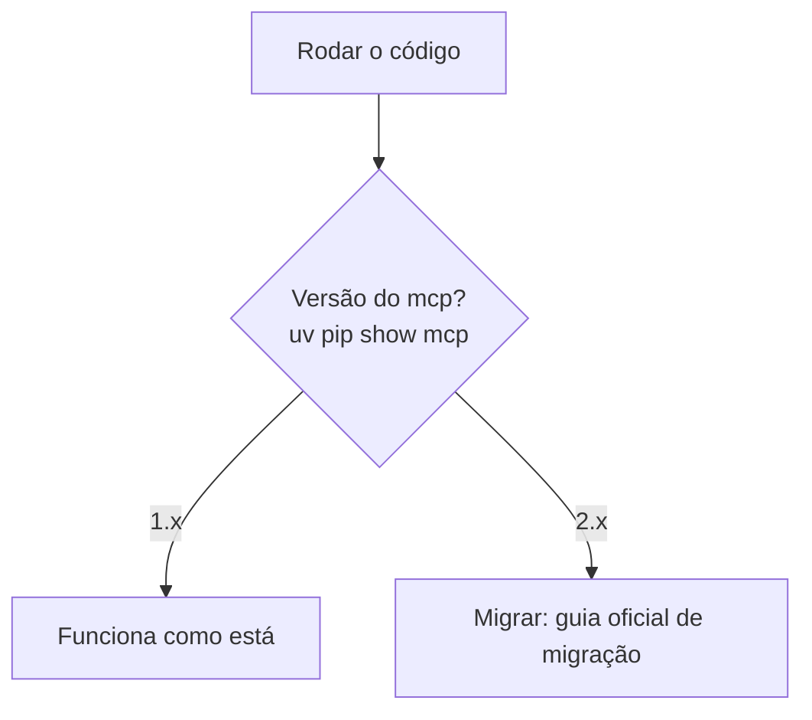

# 🔄 SDK Python: v1 × v2

Hoje, `pip install mcp` instala a **v2**. O código destas notas usa a **v1** (`mcp>=1.2,<2`).



## Servidor

```python
# v1
from mcp.server.fastmcp import FastMCP
mcp = FastMCP("research")

# v2
from mcp.server import MCPServer
mcp = MCPServer("research")

# @mcp.tool(), @mcp.resource(), @mcp.prompt() continuam iguais
```

Se você rodar código v1 com a v2: `ModuleNotFoundError: No module named 'mcp.server.fastmcp'`.

Na v2, opções de transporte como `host`, `port`, `stateless_http` e `json_response` saem do construtor.

## Cliente

```python
# v1: dois context managers + handshake manual
async with stdio_client(params) as (read, write):
    async with ClientSession(read, write) as session:
        await session.initialize()
        tools = (await session.list_tools()).tools
        schema = tools[0].inputSchema

# v2: um único objeto
from mcp import Client
async with Client(params) as client:
    tools = (await client.list_tools()).tools
    schema = tools[0].input_schema
```

Na v2, os atributos Python passaram para **snake_case** (`input_schema`, `is_error`). O JSON que trafega continua em camelCase.

> Confira os detalhes no [guia de migração oficial](https://py.sdk.modelcontextprotocol.io/migration/): ele lista todas as mudanças com código antes e depois.

## O mapa do FastMCP

| Nome | O que é |
|---|---|
| `mcp.server.fastmcp.FastMCP` | O "FastMCP 1.0", embutido no SDK oficial v1 (usado no curso) |
| `mcp.server.MCPServer` | O sucessor no SDK oficial v2 |
| Pacote `fastmcp` | Framework independente, construído em cima do SDK oficial |
